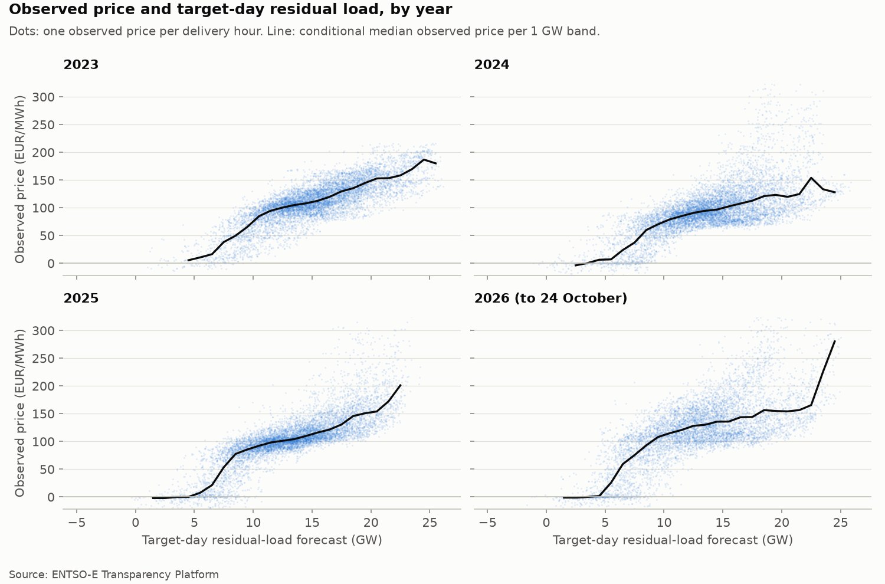

# Methodology

This document gives the details behind the [README](README.md): the data and when each series is published, the models, and how the forecasts are evaluated. The method follows three reference papers, Lago et al. (2021), Ziel and Weron (2018) and Maciejowska, Uniejewski and Weron (2022), referred to below as the papers.

The forecast is issued at 11:00 Warsaw time on d−1, one hour before the auction for delivery day d closes. Its target is the price $p_{d,h}$ of each hour h of day d on the Warsaw clock. Since October 2025 that is the mean of the hour's four quarter-hour prices, so the target means the same thing across the whole period. A delivery day has 23 hours on the spring clock change and 25 on the autumn one.

## 1. Data

### 1.1 Sources and processing

The electricity data comes from the [ENTSO-E Transparency Platform](https://transparency.entsoe.eu/) for the Polish bidding zone: day-ahead prices (12.1.D), the day-ahead total load forecast (6.1.B) and the day-ahead wind and solar generation forecast (14.1.D), with wind onshore plus offshore. It starts on 1 January 2023, which keeps the 2022 gas crisis out of training and leaves one full year before the first test day. The day-ahead prices of Germany-Luxembourg and Czechia, from the same source, serve only the check of market coupling in notebook 02.

More precisely, `ingest/entsoe.py` calls the ENTSO-E REST API for `documentType=A65`, `processType=A01` and `outBiddingZone_Domain=10YPL-AREA-----S` for `load_da_fcst`; the [API guide](https://transparency.entsoe.eu/content/static_content/download?path=%2FStatic+content%2Fweb+api%2FRestfulAPI_IG.pdf) maps that request to Article 6(1)(b), day-ahead total load. It calls `documentType=A69`, `processType=A01` and `in_Domain=10YPL-AREA-----S` for the wind-and-solar forecast under Article 14(1)(d), without a production-type filter. The response's Solar (B16), Wind Onshore (B19) and Wind Offshore (B18) series are stored separately; staging adds the two wind series and leaves solar separate. No actual load or actual solar-generation series is ingested or used in notebook 01.

The legal definition of [total load in Article 2(27)](https://eur-lex.europa.eu/legal-content/EN/TXT/?uri=CELEX:02013R0543-20200101) is a balance quantity—generation plus imports, less exports and power used for storage, including losses—not a definition of gross end-user consumption. Article 14(1)(d) requires a wind-and-solar generation forecast per bidding zone, but neither the Regulation nor the API guide specifies whether PSE's A69 forecast estimates low-voltage/prosumer PV, its self-consumption, or a particular metering population. PSE's [separate five-year planning report](https://www.pse.pl/dane-systemowe/plany-pracy-kse/plan-koordynacyjny-5-letni/wielkosci-podstawowe/opis) currently forecasts total PV generation and deducts a PV autogeneration estimate based on low-voltage prosumer capacity from its planned network demand. That documents PSE's planning convention, not the construction of the ENTSO-E A65/A69 series used here. No source found maps those products to one another or establishes their treatment over 2023–2026.

Values are stored hourly. Quarter-hour values are averaged into hours, and an hour counts only if its values are all the same length and together cover 60 minutes; otherwise it is missing.

The carbon price comes from EEX, which runs the primary auctions of emission allowances (EUA) in the EU Emissions Trading System and publishes every result free of charge. It is the clearing price of each auction of general allowances, in EUR per tonne of CO2: 1,039 auctions from 10 January 2022 to 28 October 2026.

The main models leave out fuel and carbon prices, cross-border flows and plant outages. The papers' expert models use only load and renewables forecasts as outside inputs, Lago et al.'s benchmark datasets contain no fuel or carbon prices, and yesterday's prices carry the current cost level into the forecast. Of these inputs, only the carbon price is tested, in two variants.

### 1.2 Publication times and assumptions

The forecast rests on three assumptions about the data:

1. Each series is published exactly at its deadline under EU Regulation 543/2013, because ENTSO-E does not record when each value was published.
2. The stored values are those that were public at the time. ENTSO-E can revise a value after publishing it, and the data is the version downloaded in October 2026.
3. Offshore wind is zero before 18 June 2026, the first delivery day with an offshore forecast, because no Polish offshore farm is assumed to have fed the grid before then.

The README's [table of publication times](README.md#the-forecasting-problem) shows what follows for each input at 11:00 on d−1.

The papers give their models the wind and solar forecast for day d and treat it as known on d−1 (Lago et al. 2021). Under the legal publication-deadline assumption above, that forecast is due at 18:00 on d−1, after the 11:00 issue time. ENTSO-E does not provide the actual historical publication timestamps, so this is an assumption about availability, not a claim about when each forecast was observed to appear. The main models therefore use the forecast for d−1, assumed available by 11:00. The `linear_papers` and `gbm_papers` variants substitute the target delivery day's forecast for the preceding delivery day's forecast, following the papers. The experiment measures sensitivity to input substitution across different delivery days. It does not measure the value of a revised forecast for the same delivery day available at 11:00, and cannot establish the commercial value of such an update.

An EUA auction's bidding window closes at 11:00, and EEX's reports for 2022 to 2026 time every general-allowance result between 11:00 and 11:04 on the auction day, so an auction held on d−1 is never public at 11:00. The carbon input is therefore the latest auction held on or before d−2. Auctions pause for up to four weeks over New Year, and the last price carries on until they resume.

## 2. Models

### 2.1 Inputs

The inputs are those of the expert model of Ziel and Weron (2018, Eq. 10), with the two outside inputs of Maciejowska et al. (2022, Eq. 5).

*Model inputs for hour h of delivery day d.*

| Input | Definition |
|---|---|
| $p_{d-1,h}$, $p_{d-2,h}$, $p_{d-7,h}$ | Price at hour h one, two and seven days before d |
| $p^{\text{last}}_{d-1}$ | Price at 23:00 on d−1, the hour just before d |
| $p_{d-1}^{\min}$, $p_{d-1}^{\max}$ | Lowest and highest price of d−1 |
| $L_{d,h}$ | Load forecast for hour h of d, in GW |
| $R_{d-1,h}$ | Wind plus solar forecast for hour h of d−1, in GW: the latest due by 11:00 |
| $R_{d,h}$ | Wind plus solar forecast for hour h of d, in GW: the papers' setup only |
| $D_k(d)$ | Six weekday dummies, with Wednesday as the baseline |
| $H(d)$ | 1 on a Polish public holiday, otherwise 0 |
| $C_{d-2}$ | Clearing price of the latest EUA auction held on or before d−2, in EUR/t: the carbon variants only |

Hours follow the Warsaw clock. When the clocks go forward, the missing 02:00 of an earlier day is filled with the mean of 01:00 and 03:00; when they go back, its two 02:00 values are averaged, as in Ziel and Weron. The lowest and highest price of d−1 are left missing if any hour of d−1 is missing. The holiday dummy is my addition. Ziel and Weron leave holidays out to keep the model small, but fitted on the latest year it lowers the forecast in all 24 hours, by up to 30.4 EUR/MWh at 14:00 (`slopes.py`).

Every input is checked against its publication deadline when the input table is built (`availability.py`): the build stops if one is late, apart from day d's renewables forecast, which the backtest allows only in the papers' setup. Three truncation tests check the data as well as the rule. Deleting every price from day d onwards must leave every input for day d unchanged; deleting day d's renewables forecast too must leave every input outside the papers' setup unchanged; and deleting every auction from d−1 onwards must leave the carbon input unchanged.

Load and renewables are outside inputs. Their difference, load minus wind and solar, is an arithmetic residual-load proxy that gives economic intuition for why a higher quantity to be met by other sources can be associated with a higher auction price. It is not a verified measure of demand left for dispatchable plants: the ENTSO-E A65 and A69 documentation does not establish their common treatment of behind-the-meter PV. Notebook 01 compares the price relationship on a common sample in each year. The retrospective target-day proxy, which uses day d's renewables forecast, has a Spearman correlation with price of 0.69 to 0.86 in 2023 to 2026, against 0.18 to 0.53 for load alone. Replacing that renewables forecast with the day d−1 forecast available to the main models gives an operational proxy with correlations of 0.56 to 0.73. This descriptive comparison does not identify an accounting convention, the effect of forecast availability, or a model's expected MAE change.



*Observed price against retrospective target-day residual load, one panel per year. The line is the conditional median observed price in each 1 GW band, not an estimated supply curve. From `notebooks/01_exploratory_data_analysis.ipynb`.*

### 2.2 Benchmarks

The weekly naive copies the same hour one week earlier:

```math
\hat p_{d,h} = p_{d-7,h}
```

The similar-day naive copies the most recent day of the same kind:

```math
\hat p_{d,h} =
\begin{cases}
p_{d-1,h} & \text{if } d \text{ is a Tuesday, Wednesday, Thursday or Friday} \\[4pt]
p_{d-7,h} & \text{if } d \text{ is a Saturday, Sunday or Monday}
\end{cases}
```

From Tuesday to Friday the day before is also a working day, so it is copied. For Saturday, Sunday and Monday the day before is a different kind of day, so the same weekday one week earlier is copied instead. Public holidays get no rule of their own: a holiday on a Thursday is forecast from Wednesday, and the Friday after it from the holiday. This is the naive benchmark of Ziel and Weron (2018, Eq. 9) and the default in epftoolbox, the library that accompanies Lago et al.

### 2.3 Linear expert model

One ordinary least squares regression is fitted for each hour h, so each of its 16 coefficients takes a separate value for every hour:

```math
\begin{aligned}
p_{d,h} = {} & \underbrace{\beta_0 + \beta_1\, p_{d-1,h} + \beta_2\, p_{d-2,h} + \beta_3\, p_{d-7,h}}_{\text{same hour on earlier days}}
\; + \; \underbrace{\beta_4\, p^{\text{last}}_{d-1} + \beta_5\, p^{\min}_{d-1} + \beta_6\, p^{\max}_{d-1}}_{\text{the day before}} \\[8pt]
& + \underbrace{\beta_7\, L_{d,h} + \beta_8\, R_{d-1,h}}_{\text{load and renewables}}
\; + \; \underbrace{\textstyle\sum_{k=1}^{6} \theta_k\, D_k(d) + \delta\, H(d)}_{\text{weekday and holiday}}
\; + \; \varepsilon_{d,h}
\end{aligned}
```

With load and renewables in GW, $\beta_7$ and $\beta_8$ read in EUR/MWh per GW, and the intercept and the dummies in EUR/MWh. Prices enter raw, as in Maciejowska et al. I fit the model by least squares and score it by mean absolute error (MAE), as the papers do, so that it stays comparable with them. Lago et al.'s linear benchmark is LEAR, a LASSO model with many more inputs; I chose the expert model of the other two papers because it is the standard small benchmark, with nothing to tune.

### 2.4 Gradient-boosted trees

The trees are scikit-learn's `HistGradientBoostingRegressor`, one model for all 24 hours. Its inputs $x_{d,h}$ are those of the linear model plus the hour h, with the weekday as one number (0 for Monday) instead of dummies. The forecast starts from the median training price $f_0$ and adds 400 regression trees $f_m$, each scaled by the learning rate $\nu = 0.05$:

```math
\hat p_{d,h} = f_0 + \nu \sum_{m=1}^{400} f_m(x_{d,h})
```

Each tree has at most 31 leaves and at least 40 training hours per leaf, and is grown to reduce the absolute error, the measure the model is scored on. With this loss each leaf's value is the median residual of its training hours, and the L2 penalty of 1.0 acts only on the choice of splits. The settings are fixed and the same in every run. Tuning them would need a validation period before the test, and the only data before the first test day is the year the first model trains on. Lago et al.'s nonlinear benchmark is a deep neural network. I use trees instead because a fit takes about a second, which makes daily retraining practical, and they need no architecture search.

### 2.5 Variants

Each variant changes one thing about a main model. In the papers' setup, `linear_papers` and `gbm_papers`, day d's renewables forecast $R_{d,h}$ replaces $R_{d-1,h}$. The resulting MAE comparison is a retrospective sensitivity to substituting forecasts for consecutive delivery days, not a same-day forecast-vintage comparison. `gbm_defaults` uses scikit-learn's default learning rate, number of trees, minimum leaf size and L2 penalty, and keeps the absolute-error loss.

`linear_eua` and `gbm_eua` add the carbon price $C_{d-2}$ to the main models; in the linear model it is a seventeenth coefficient per hour, in EUR/MWh per EUR/t. They were set up as variants before they were run, so their result cannot choose the main models.

`linear_asinh` fits the linear model to asinh-transformed prices, as Ziel and Weron do. The target and the six price inputs are transformed with $m$, the median of the training window's prices, and $s$, 1.4826 times their median absolute deviation, and each forecast is transformed back:

```math
z = \text{asinh}\!\left(\frac{p - m}{s}\right), \qquad \hat p = m + s \sinh(\hat z)
```

## 3. Forecast evaluation

### 3.1 Walk-forward backtest

For each delivery day d from 1 January 2024, a fresh model is trained on the 365 days from d−365 to d−1 and forecasts the hours of d. Day d−1's prices come out of the auction on d−2, so every training price was known at 11:00 on d−1.

Retraining every day, as the papers do, gives each forecast the latest prices and the latest relationship between price, load and renewables. The 365-day window is the most the data allows on the first test day and lies within the range of Lago et al.'s windows; being fixed, it gives every forecast the same length of history, with each season in it once. Ziel and Weron use 730 days, and Lago et al. average the forecasts of four windows, from 56 days to 4 years.

A training row with a missing input is dropped. A test hour with a missing input gets no forecast, and every model is scored on the 24,671 hours all of them forecast, so no model gains by skipping hard hours.

### 3.2 Accuracy measures

Accuracy is measured by MAE over the $N$ hours scored, and by relative MAE (rMAE), which divides a model's MAE by the weekly naive's on the same hours (Lago et al.):

```math
\begin{aligned}
\text{MAE} &= \frac{1}{N} \sum_{d,h} \bigl\lvert \hat p_{d,h} - p_{d,h} \bigr\rvert \\[8pt]
\text{rMAE} &= \frac{\text{MAE}}{\text{MAE}_{\text{weekly naive}}}
\end{aligned}
```

Lago et al. recommend the weekly naive for relative MAE, but here it is the weaker of the two naive forecasts, so I state the headline gain against the similar-day naive.

### 3.3 Significance tests

A Diebold-Mariano (DM) test compares the predictive accuracy of model A and model B on daily MAE. The null hypothesis is equal expected daily MAE. With $\text{MAE}_d$ a model's MAE over the hours of day d and $n$ delivery days, define the loss difference as model B minus model A:

```math
\begin{aligned}
\Delta_d &= \text{MAE}^{B}_d - \text{MAE}^{A}_d \\[8pt]
\text{DM} &= \frac{\bar\Delta}{\sqrt{\hat\sigma^2 / n}} \\[8pt]
\hat\sigma^2 &= \hat\gamma_0 + 2 \sum_{k=1}^{7} \Bigl(1 - \frac{k}{8}\Bigr) \hat\gamma_k
\end{aligned}
```

Positive $\Delta_d$ means model A has lower daily MAE. $\hat\gamma_k$ is the sample autocovariance of $\Delta_d$ at lag $k$, and the sum is a Newey–West heteroskedasticity and autocorrelation consistent (HAC) estimate with a Bartlett kernel and seven lags. Seven days is the retained primary bandwidth; the report also checks 14 and 28 lags as robustness diagnostics, without selecting a bandwidth from their p-values.

Each DM test is two-sided because the direction of an accuracy difference is not fixed before observing the backtest. The p-value uses the standard-normal asymptotic approximation to the DM statistic. Its validity requires a sufficiently stable daily loss-difference process with weak enough dependence for the HAC estimate and central limit theorem to apply. The HAC estimate accommodates heteroskedasticity and autocorrelation of the form covered by those conditions; it does not make the test robust to arbitrary structural breaks or strong persistent dependence.

There are two multiplicity families, each tested at 5%. The four main models make six unique unordered comparisons. Their six raw two-sided p-values receive Holm's step-down adjustment. The six variant-versus-main comparisons form a separate, exploratory family with their own Holm adjustment. Full-precision p-values are adjusted before reporting. The adjustment controls the family-wise error rate within each family, but it does not remove the limitation of choosing or evaluating variants on the same test period.

### 3.4 Differences from the reference papers

*Where this project departs from the papers.*

| Choice | The papers | This project |
|---|---|---|
| Renewables forecast | For day d, treated as known on d−1 | Forecast for d−1 in the main models; forecast for d in the sensitivity variants |
| Holidays | Weekday dummies only | A holiday dummy as well |
| Training window | 730 days (Ziel and Weron); four windows from 56 days to 4 years, averaged (Lago et al.) | 365 days |
| Linear model | LEAR, a LASSO model with many inputs (Lago et al.) | The expert model, by OLS |
| Prices | asinh-transformed (Ziel and Weron) | Raw, as in Maciejowska et al.; asinh in a variant |
| Nonlinear model | A deep neural network (Lago et al.) | Gradient-boosted trees |
| Significance test | Diebold-Mariano | The same, with a Newey-West standard error |
| Target since October 2025 | The papers predate 15-minute products | The mean of the four quarter-hours |

## References

- Lago, J., Marcjasz, G., De Schutter, B., Weron, R. (2021). Forecasting day-ahead electricity prices: A review of state-of-the-art algorithms, best practices and an open-access benchmark. *Applied Energy* 293, 116983. [arXiv:2008.08004](https://arxiv.org/abs/2008.08004)
- Ziel, F., Weron, R. (2018). Day-ahead electricity price forecasting with high-dimensional structures: Univariate vs. multivariate modeling frameworks. *Energy Economics* 70, 396–420. [arXiv:1805.06649](https://arxiv.org/abs/1805.06649)
- Maciejowska, K., Uniejewski, B., Weron, R. (2022). Forecasting electricity prices. [arXiv:2204.11735](https://arxiv.org/abs/2204.11735)
- Diebold, F. X., Mariano, R. S. (1995). Comparing predictive accuracy. *Journal of Business & Economic Statistics* 13(3), 253–263.
- Newey, W. K., West, K. D. (1987). A simple, positive semi-definite, heteroskedasticity and autocorrelation consistent covariance matrix. *Econometrica* 55(3), 703–708.
- Commission Regulation (EU) No 543/2013 on submission and publication of data in electricity markets.

Data: ENTSO-E Transparency Platform; EEX, [EUA primary auction reports](https://www.eex.com/en/market-data/market-data-hub/environmentals/eex-eua-primary-auction-spot-download).
