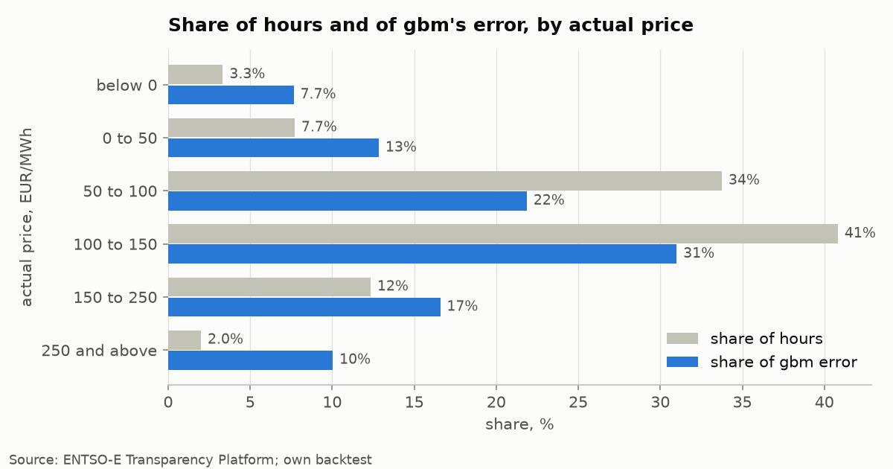

# Polish day-ahead electricity price forecast

This project forecasts Polish day-ahead electricity prices at **11:00 Warsaw time on the day before delivery**, one hour before bids close. It compares a linear expert model and gradient-boosted trees with two naive benchmarks over 1,028 delivery days, from 1 January 2024 to 24 October 2026.

Both models reduce mean absolute error (MAE) by about **22%** against the similar-day benchmark. The trees achieve 21.18 EUR/MWh and the linear model 21.30, against 27.34 for the benchmark; their difference is not statistically significant. The backtest assumes inputs were available at their publication deadlines and uses archived values, which may include later revisions.


*MAE on the 24,671 hours forecast by every model. The lighter bars show sensitivity variants using the target delivery day's renewables forecast, due after gate closure under the project's timing assumption.*

## The forecasting problem

Poland participates in Single Day-Ahead Coupling, the European day-ahead auction. Bids for delivery day d close at 12:00 Warsaw time on d−1. This project issues its forecast at 11:00, using only inputs assumed public by then. Including later information would introduce look-ahead bias.

The target is the hourly price in EUR/MWh. Since the switch to 15-minute products on 1 October 2025, it is the mean of each hour's four quarter-hour prices.

*Publication times in Warsaw time: legal deadlines under EU Regulation 543/2013 for ENTSO-E series, and reported result times for EEX auctions. The backtest assumes publication at these deadlines; actual historical publication times are unavailable.*

| Time | Published | At 11:00 on d−1 |
|---|---|---|
| 11:00 to 11:04 on d−2 | Result of an EUA auction held on d−2 (EEX) | Public: the carbon variants' input |
| 13:00 on d−2 | Prices for d−1 (Art. 12(2)(d)) | Public |
| 18:00 on d−2 | Wind and solar forecast for d−1 (Art. 14(2)(d)) | Public: the main models' renewables input |
| 10:00 on d−1 | Load forecast for d (Art. 6(2)(b)) | Public |
| **11:00 on d−1** | **The forecast is issued** | |
| 11:00 to 11:04 on d−1 | Result of an EUA auction held on d−1 (EEX) | Not yet |
| 12:00 on d−1 | Gate closure for d | |
| 13:00 on d−1 | Prices for d | Not yet: the target |
| 18:00 on d−1 | Wind and solar forecast for d (Art. 14(2)(d)) | Not yet: used only by the papers' setup |

The reference papers treat day d's renewables forecast as known on d−1. Under this project's deadline assumption, it arrives too late, so the main models use the forecast for d−1. The sensitivity variants substitute day d's forecast. This compares inputs for different delivery days; it does not measure the value of a revised forecast for the same delivery day available at 11:00.

## Models and backtest

The **weekly naive** copies prices from the same weekday one week earlier. The **similar-day naive** copies yesterday's prices from Tuesday to Friday, and the previous week's prices for Saturday, Sunday and Monday.

The **linear expert model** fits a separate regression for each hour using lagged prices, load and renewables forecasts, and calendar indicators. The **gradient-boosted trees** use the same inputs plus the hour in a single model. Both retrain daily on the preceding 365 days, producing out-of-sample forecasts.

The design follows [Ziel and Weron (2018)](https://arxiv.org/abs/1805.06649), [Maciejowska, Uniejewski and Weron (2022)](https://arxiv.org/abs/2204.11735) and [Lago et al. (2021)](https://arxiv.org/abs/2008.08004). [METHODOLOGY.md](METHODOLOGY.md) documents the inputs, formulas, assumptions and departures from the papers.

## Results

### Main models

*MAE on the 24,671 hours forecast by every model, 1 January 2024 to 24 October 2026. Relative MAE divides each model's MAE by the weekly naive's on the same hours.*

| Model | MAE (EUR/MWh) | Relative MAE vs weekly naive | MAE change vs similar-day naive |
|---|---|---|---|
| Gradient-boosted trees (`gbm`) | 21.18 | 0.65 | −22.5% |
| Linear expert model (`linear`) | 21.30 | 0.65 | −22.1% |
| Similar-day naive (`naive_similar_day`) | 27.34 | 0.84 | 0% |
| Weekly naive (`naive_weekly`) | 32.56 | 1.00 | +19.1% |

Two-sided Diebold-Mariano tests compare daily MAE, with Holm adjustment across the six main-model comparisons at 5%. The test does not detect a difference between the trees and linear model (raw and adjusted p = 0.547); the other five comparisons have adjusted p < 0.001.

The trees lead in 2024 (18.59 against 19.09 EUR/MWh) and trail slightly in 2025 and 2026. All models' errors rise after October 2025, but the trees' relative MAE stays at 0.65. This split cannot separate the switch to 15-minute products from the more volatile prices of 2026. [The results report](reports/results.md) includes all period breakdowns and statistical tests.

### Variants

Each variant changes one aspect of a main model and is scored on the same hours.

*MAE in EUR/MWh. Two-sided DM tests use daily MAE, with a separate Holm adjustment across the six exploratory comparisons. P-values are rounded here; the results report retains full precision.*

| Variant | What changes | MAE of the main model | MAE of the variant | Difference | Raw p | Holm p | Significant after Holm |
|---|---|---|---|---|---|---|---|
| `linear_papers` | Substitutes the target delivery day's renewables forecast for the preceding delivery day's forecast, as in the papers | 21.30 | 18.30 | −3.01 | <0.001 | <0.001 | Yes |
| `gbm_papers` | Substitutes the target delivery day's renewables forecast for the preceding delivery day's forecast, as in the papers | 21.18 | 16.95 | −4.23 | <0.001 | <0.001 | Yes |
| `linear_asinh` | Fits on asinh-transformed prices | 21.30 | 20.67 | −0.63 | <0.001 | <0.001 | Yes |
| `gbm_defaults` | Uses scikit-learn's default settings | 21.18 | 21.30 | +0.11 | 0.125 | 0.375 | No |
| `linear_eua` | Adds the carbon price | 21.30 | 21.28 | −0.02 | 0.810 | 1.000 | No |
| `gbm_eua` | Adds the carbon price | 21.18 | 21.12 | −0.06 | 0.529 | 1.000 | No |

Substituting the target delivery day's renewables forecast produces the largest improvement. The asinh transform lowers the linear model's MAE by 3.0%; raw prices remain the main specification to avoid choosing the model on test results. Adding carbon prices brings no significant gain, and the two tested tree configurations perform similarly.

These variants are exploratory. Holm adjustment accounts for the six comparisons, but does not remove the bias from choosing variants on the same period used to evaluate them.

### Where the forecast fails



*Share of hours and of the trees' total absolute error by actual price band, on the common evaluation sample.*

[Notebook 02](notebooks/02_error_analysis.ipynb) examines three patterns:

- **Extreme prices account for a disproportionate share of error.** Hours below 0 or at 250 EUR/MWh and above make up 5.3% of hours but 17.7% of the trees' total absolute error. Forecasts are too moderate in these bands, partly because the bands are selected using realised prices.
- **Daily bias is associated with the difference between consecutive days' renewables forecasts.** The Spearman correlation is 0.59 for the trees and 0.56 for the linear model, but also 0.50 for the similar-day naive, which has no renewables input. This is an association, not an estimate of error removable by better forecasts.
- **The trees under-forecast on days selected for high operational residual load.** Among days at or above the 95th percentile of the preceding 60 days of the same type, mean errors at the peak proxy hour are −36, −19 and −21 EUR/MWh in 2024–2026, on 25, 42 and 25 days. Medians are −13, −1 and +9. These are descriptive results, without a formal test of conditional bias.

The ten worst days split evenly between under- and over-forecasts. Substituting the target day's renewables forecast reduces average daily MAE from 83.2 to 73.9 EUR/MWh on the under-forecast days and from 67.2 to 44.8 on the over-forecast days. It reduces but does not eliminate the errors; the analysis does not identify the drivers of the remaining error.

## Limitations

**Historical availability is assumed.** Archived forecasts may include later revisions, and actual publication may precede the legal deadline. PSE publishes a separate forecast product, but its available history does not preserve every past version; it is not evaluated here. These uncertainties prevent a fully verified point-in-time backtest.

**Residual load is an arithmetic proxy.** The charts subtract forecast wind and solar from forecast load. The source definitions do not establish whether the Polish series treat behind-the-meter solar consistently, so the result is not a verified measure of demand left for dispatchable plants. The models use load and renewables separately.

**Accuracy is not trading value.** The project evaluates hourly point forecasts for one market over 2024–2026, without prediction intervals or a trading simulation. The main models omit fuel, carbon, flow and outage data; only carbon is tested separately. Lower MAE alone does not establish better bidding or higher P&L.

## Repository structure

```
METHODOLOGY.md       data, timing assumptions, models and evaluation
src/pl_dayahead/     ingestion, feature construction, models and backtesting
notebooks/
  01_exploratory_data_analysis.ipynb   price patterns and residual load
  02_error_analysis.ipynb             forecast errors and selected case studies
reports/            results tables and figures
tests/              data, availability, model and evaluation checks
```

## Reproducing the results

Requirements: Python 3.13, [uv](https://docs.astral.sh/uv/) and a free ENTSO-E API token (see the platform's [knowledge base](https://transparencyplatform.zendesk.com/)). Put the token in `.env` in the project root:

```
ENTSOE_API_TOKEN=your-token
```

Then run:

```
uv sync
uv run python -m pl_dayahead.ingest.entsoe --end 2026-10-25
uv run python -m pl_dayahead.ingest.eex
uv run python -m pl_dayahead.staging
uv run python -m pl_dayahead.backtest
uv run python -m pl_dayahead.evaluate
uv run pytest
```

The end date includes delivery days through 24 October 2026; omitting it extends the download to the current month. Later ENTSO-E revisions may cause a fresh download to differ from the published snapshot.

EEX reports need no token. The database (`data/pl_power.duckdb`) and downloaded reports (`data/eex`) are excluded from the repository. The full backtest takes about 35 minutes. Open the notebooks with `uv run jupyter lab`.

## Use of AI tools

I used an AI coding assistant for code, draft text and methodological discussion. I made the design decisions and checked the reported results by script against the results report or notebook outputs.

## License

MIT. See [LICENSE](LICENSE).
