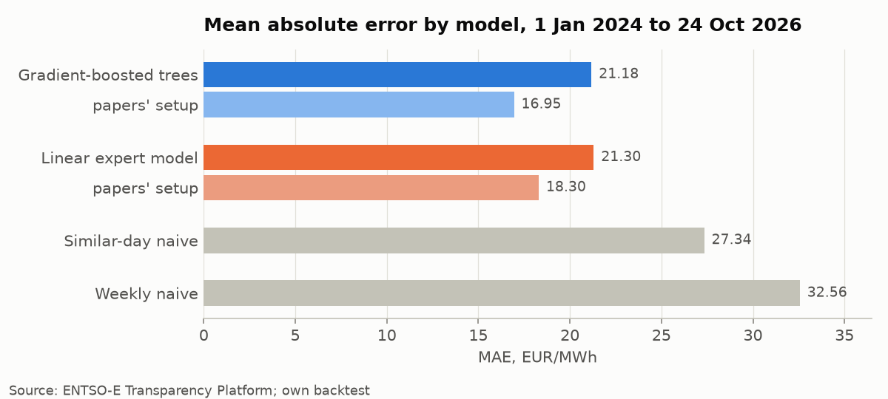

# Polish day-ahead electricity price forecast

This project forecasts hourly prices in the Polish day-ahead auction at 11:00 Warsaw time on the day before delivery, one hour before bids close, using only information published by then. A linear expert model and gradient-boosted trees are tested against two naive benchmarks, which copy earlier prices, in a walk-forward backtest over 1,028 delivery days, from 1 January 2024 to 24 October 2026.

Both models cut the mean absolute error (MAE) by 22% against the similar-day naive benchmark: 21.18 EUR/MWh for the trees and 21.30 for the linear model, against 27.34. The difference between the two is not significant. At 11:00 the models use the wind and solar forecast for the preceding delivery day. A sensitivity variant substitutes the target delivery day's forecast, due at 18:00 under the publication-deadline assumption; this is an ex-post input substitution, not a revised forecast for the same delivery day. The daily bias is associated with the difference between these forecasts for consecutive delivery days (Spearman rank correlation 0.59 for the trees and 0.56 for the linear model). This association does not establish that a better same-day forecast at 11:00 would produce the same improvement.



*Mean absolute error on the 24,671 hours every model forecast. The lighter bars are the papers' setup: the same models given the target delivery day's wind and solar forecast instead of the preceding delivery day's forecast. Under the publication-deadline assumption, that input is due only after bids close. From `src/pl_dayahead/evaluate.py`.*

## The forecasting problem

Poland's day-ahead electricity price is set in Single Day-Ahead Coupling, the European day-ahead auction. Bids for delivery day d close at 12:00 Warsaw time on d−1, the gate closure, and the auction sets a price for every hour of d in EUR/MWh, or every quarter-hour since 1 October 2025. The target is the hourly price, since then the mean of the hour's four quarter-hour prices. A desk that bids in the auction needs its forecast before gate closure, so the forecast is issued at 11:00 on d−1 and every input must be public by then. An input published later would give the backtest look-ahead bias: it would score a forecast no desk could have issued. ENTSO-E does not record when each value was published, so each series is taken to be published exactly at its legal deadline.

*Publication times around the forecast, Warsaw time: the legal deadlines of the ENTSO-E series under EU Regulation 543/2013, and the result times in EEX's auction reports.*

| Time | Published | At 11:00 on d−1 |
|---|---|---|
| 11:00 to 11:04 on d−2 | Result of an EUA auction held on d−2 (EEX) | Public: the carbon variants' input |
| 13:00 on d−2 | Prices for d−1 (Art. 12(2)(d)) | Public |
| 18:00 on d−2 | Wind and solar forecast for d−1 (Art. 14(2)(d)) | Public: the main models' renewables input |
| 10:00 on d−1 | Load forecast for d (Art. 6(2)(b)) | Public |
| **11:00 on d−1** | **The forecast is issued** | |
| 11:00 to 11:04 on d−1 | Result of an EUA auction held on d−1 (EEX) | Not yet |
| 12:00 on d−1 | Gate closure for d | |
| 13:00 on d−1 | Prices for d | Not yet: the target |
| 18:00 on d−1 | Wind and solar forecast for d (Art. 14(2)(d)) | Not yet: used only by the papers' setup |

The papers this project follows give their models the wind and solar forecast for day d and treat it as known on d−1. Its deadline is after gate closure, so the main models use the forecast for d−1. That makes them ex-ante forecasts under the publication-deadline assumption. The papers' setup substitutes day d's forecast for day d−1's forecast. It is an ex-post input-substitution sensitivity between different delivery days; it does not measure the value of a revised forecast for day d available at 11:00.

## Models and backtest

The weekly naive copies the price of the same hour one week earlier. The similar-day naive copies the day before from Tuesday to Friday, and the same day one week earlier for Saturday, Sunday and Monday. The linear expert model fits one least-squares regression for each hour on the same hour's price one, two and seven days earlier, the previous day's last, lowest and highest price, the load and the wind and solar forecasts, and weekday and holiday dummies. The gradient-boosted trees (scikit-learn) take the same inputs plus the hour, in one model for all hours. The inputs and models follow [Ziel and Weron (2018)](https://arxiv.org/abs/1805.06649), [Maciejowska, Uniejewski and Weron (2022)](https://arxiv.org/abs/2204.11735) and [Lago et al. (2021)](https://arxiv.org/abs/2008.08004).

For each delivery day from 1 January 2024, both models are retrained on the 365 days before it, so every forecast is out of sample. Two-sided Diebold-Mariano tests on daily MAE test equal predictive accuracy. The six unique main-model comparisons use Holm adjustment at 5%; the six exploratory variant comparisons use a separate Holm adjustment. [METHODOLOGY.md](METHODOLOGY.md) gives the details: the assumptions about the data, the formulas, and where this project departs from the papers.

## Results

Every table, including results by period, year, month and local hour and the full Diebold-Mariano table, is in [`reports/results.md`](reports/results.md).

### Main models

*MAE on the 24,671 hours every model forecast, 1 January 2024 to 24 October 2026. Relative MAE divides a model's MAE by the weekly naive's on the same hours.*

| Model | MAE (EUR/MWh) | Relative MAE vs weekly naive | MAE change vs similar-day naive |
|---|---|---|---|
| Gradient-boosted trees (`gbm`) | 21.18 | 0.65 | −22.5% |
| Linear expert model (`linear`) | 21.30 | 0.65 | −22.1% |
| Similar-day naive (`naive_similar_day`) | 27.34 | 0.84 | 0% |
| Weekly naive (`naive_weekly`) | 32.56 | 1.00 | +19.1% |

- Both models cut the error by 22% against the similar-day naive, and their difference is not significant: the two-sided `gbm`–`linear` p-value is 0.547 before and after Holm adjustment. The other five main-model comparisons remain significant after the six-comparison Holm adjustment (all adjusted p < 0.001).
- The trees lead in 2024 (18.59 against 19.09 EUR/MWh) and trail slightly in 2025 and 2026.
- The weekly naive's MAE rose from 29.86 to 36.99 EUR/MWh after 1 October 2025, and every other model's error rose with it. The trees' relative MAE was 0.65 in both periods, so their error grew in step with the benchmark's. The split cannot separate the switch to 15-minute products from 2026 being a more volatile year.

### Variants

Each variant changes one thing about a main model and is scored on the same hours.

*Each variant against its main model, MAE in EUR/MWh. The two-sided DM tests use daily MAE. Raw and Holm-adjusted p-values are rounded here; [the results report](reports/results.md) retains full precision. Holm adjustment is across the six exploratory variant comparisons.*

| Variant | What changes | MAE of the main model | MAE of the variant | Difference | Raw p | Holm p | Significant after Holm |
|---|---|---|---|---|---|---|---|
| `linear_papers` | Substitutes the target delivery day's renewables forecast for the preceding delivery day's forecast, as in the papers | 21.30 | 18.30 | −3.01 | <0.001 | <0.001 | Yes |
| `gbm_papers` | Substitutes the target delivery day's renewables forecast for the preceding delivery day's forecast, as in the papers | 21.18 | 16.95 | −4.23 | <0.001 | <0.001 | Yes |
| `linear_asinh` | Fitted on asinh-transformed prices | 21.30 | 20.67 | −0.63 | <0.001 | <0.001 | Yes |
| `gbm_defaults` | scikit-learn's default settings | 21.18 | 21.30 | +0.11 | 0.125 | 0.375 | No |
| `linear_eua` | The carbon price added | 21.30 | 21.28 | −0.02 | 0.810 | 1.000 | No |
| `gbm_eua` | The carbon price added | 21.18 | 21.12 | −0.06 | 0.529 | 1.000 | No |

- Replacing the preceding delivery day's renewables forecast with day d's forecast reduces MAE from 21.30 to 18.30 EUR/MWh for the linear model and from 21.18 to 16.95 for the trees (both Holm-adjusted p < 0.001). This sensitivity does not quantify the value of an improved same-day forecast available at 11:00.
- The tree settings barely matter: with scikit-learn's defaults the trees' MAE is 0.11 EUR/MWh higher, and the difference is not significant after Holm adjustment (p = 0.375).
- Fitting the linear model on asinh-transformed prices lowers its MAE by 3.0% (Holm-adjusted p < 0.001), because the transform damps the pull of extreme prices on the least-squares fit. I keep raw prices in the main model, because adopting the transform after seeing it win on the test period would choose the model on the test data.
- The carbon price makes no significant difference after Holm adjustment (p = 1.000 for either model): it lowers the linear model's MAE by 0.02 EUR/MWh and the trees' by 0.06. A likely reason is that yesterday's prices already carry the cost of carbon into the forecast.
- These variants are exploratory sensitivity analyses. Holm adjustment controls the six reported comparisons, but it does not remove the selection and evaluation bias from using the same test period to choose variants.

### Where the forecast fails

The error analysis is in [notebook 02](notebooks/02_error_analysis.ipynb).


*Share of hours and share of the trees' error by actual price band. From `notebooks/02_error_analysis.ipynb`.*

- Hours below 0 or at 250 EUR/MWh and above are 5.3% of all hours but carry 17.7% of the trees' error. The forecasts there are far too moderate, partly because sorting hours by the actual price puts in those bands the hours where something unforeseen moved the price.
- The ten worst days, the worst 1% of the 1,028 by the trees' daily MAE, split evenly between under- and over-forecasts. On five, prices were high all day. On the other five the price fell, four of them with strong wind, and on those five the papers' setup averaged an MAE of 44.8 EUR/MWh against 67.2 for the trees. At Poland's daily maximum on 12 and 13 January 2026, its same-hour price was 393 and 370 EUR/MWh above Germany-Luxembourg and 255 and 250 above Czechia. These are contemporaneous zonal price differences; the price data alone does not identify their cause.
- The trees' daily bias is associated with the difference between the forecast for the target delivery day and the forecast for the preceding delivery day. Over all 1,028 days its Spearman rank correlation is 0.59, against 0.56 for the linear model, 0.50 for the similar-day naive, 0.27 for the weekly naive and 0.19 for the papers' setup. The similar-day naive has no renewables input, so the association is descriptive rather than evidence of a causal effect or of error removable by better weather forecasts. On nine of the ten worst days the bias had the same sign as this cross-delivery-day difference.

## Limitations

Two assumptions about the data can be wrong in both directions: that each series is published exactly at its deadline, and that the stored values are the ones public at the time. The stored load forecast may be a later update than the version public at 11:00, which would flatter the models. Day d's renewables forecast may have been public before 11:00, which would put the papers' setup within reach. The archive cannot settle either question.

Every statement here about which wind and solar forecast is public at 11:00 refers to the ENTSO-E series used by the main models. PSE, the Polish transmission system operator, separately publishes forecasts in its own reports. Its report [`pk5l-wp`](https://api.raporty.pse.pl/api/pk5l-wp) held hourly forecasts for the 12th and later days by 02:30 Warsaw time on 11 November 2026. It keeps only the latest version of each hour, so that forecast cannot be backtested with point-in-time history. The PSE series is distinct from the ENTSO-E inputs and is not evaluated here.

The residual-load charts in notebook 01 use the ENTSO-E day-ahead total-load forecast less its wind-and-solar forecast. The legal data-item definitions do not say whether those two Polish series apply the same treatment to behind-the-meter PV. PSE documents a separate planning product that estimates prosumer PV autogeneration, but does not identify it as the ENTSO-E series used here. Residual load is therefore an economic proxy rather than a verified measure of the demand left for dispatchable plants; the models still take load and renewables as separate features.

The main models see only Polish electricity data, with no fuel, carbon, flow or outage data, so they react to a cost shock only once it shows up in prices; of these inputs, only carbon is tested. Trees cannot forecast outside the price range of their training window; the linear model can, but in this backtest it also under-forecast price spikes, here the hours at 250 EUR/MWh and above: its bias in those hours was −92.9 EUR/MWh, against −104.6 for the trees. The target is hourly, while the auction has traded 15-minute products since October 2025, and the results cover one market and one period, 2024 to 2026.

The forecast is a point forecast, one number per hour with no range of likely prices. It is scored on accuracy alone, and what it would be worth to a desk in money, for example as bids in the auction, is not measured.

## Repository structure

```
METHODOLOGY.md                         the data, publication times, models and evaluation in detail, with the formulas
src/pl_dayahead/
  ingest/entsoe.py   download from ENTSO-E, one month at a time, into entsoe_latest
  ingest/eex.py      download EEX's EU ETS auction results into eua_auctions
  store.py           the DuckDB database: the ENTSO-E series, one row per series and time, the auctions and the forecasts
  staging.py         one row per UTC hour in the hourly table
  timeutils.py       delivery days, clock changes, Polish public holidays, the 11:00 issue time
  availability.py    publication rules and the timing check
  features.py        model inputs, each checked by availability.py
  models/            naive.py, linear.py, boosting.py, and the list of models and variants
  backtest.py        daily walk-forward backtest into the predictions table
  evaluate.py        MAE, relative MAE, Diebold-Mariano tests, reports/results.md, the headline chart
  slopes.py          the linear model's latest coefficients
  style.py           the colours, chart settings and table captions shared by evaluate.py and the notebooks
notebooks/
  01_exploratory_data_analysis.ipynb   price level, intraday profile, negative prices and the price–residual-load relationship
  02_error_analysis.ipynb              where the forecasts fail: error by time and price level, the worst days, drivers
tests/                                 pytest suite, 131 tests
```

## Reproducing the results

Requirements: Python 3.13 (the version used here), [uv](https://docs.astral.sh/uv/) and a free ENTSO-E API token (register on the Transparency Platform and request RESTful API access, as its [knowledge base](https://transparencyplatform.zendesk.com/) describes). Put the token in a file named `.env` in the project root:

```
ENTSOE_API_TOKEN=your-token
```

Then, from the project root:

```
uv sync
uv run python -m pl_dayahead.ingest.entsoe --end 2026-10-25
uv run python -m pl_dayahead.ingest.eex
uv run python -m pl_dayahead.staging
uv run python -m pl_dayahead.backtest
uv run python -m pl_dayahead.evaluate
uv run pytest
```

`--end 2026-10-25` stops the download after 24 October 2026, the last delivery day of the published backtest; without it the download runs to the current month and the backtest covers more days. ENTSO-E can revise values after publishing them, so a fresh download may not match the October 2026 one exactly.

The EEX reports need no token. The data is stored in `data/pl_power.duckdb` and the downloaded reports in `data/eex`, neither of which is part of the repository. The backtest runs every model and variant in about 35 minutes; the four tree models take most of that time, because each fits 1,028 models. Open the notebooks with `uv run jupyter lab`.

## Use of AI tools

The code and drafts of the text were written with an AI coding assistant, which I also consulted on the method. The design decisions are mine, each one tied to the reference papers, and the tests check the rules they set. Every result in this README was checked by script against `reports/results.md` or a notebook output.

## License

MIT. See [LICENSE](LICENSE).
