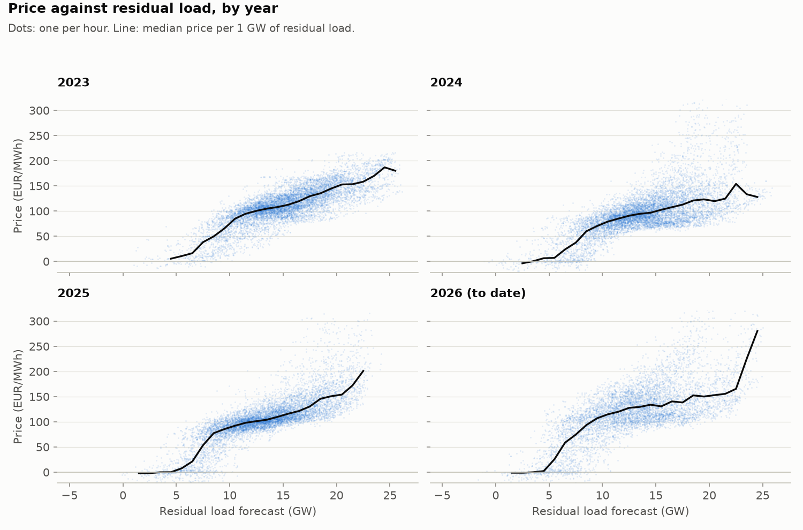
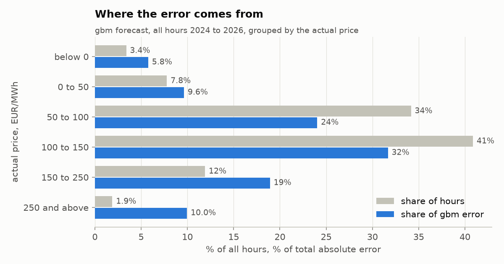

# Polish day-ahead electricity price forecast

This project forecasts the 24 hourly prices of the Polish day-ahead auction for the next delivery day. Each forecast is issued at 11:00 Warsaw time, one hour before the auction closes. The methods follow the electricity price forecasting literature (Lago et al. 2021; Ziel and Weron 2018; Maciejowska, Uniejewski and Weron 2022). A linear expert model and gradient-boosted trees are tested against two naive benchmarks over 1,012 delivery days, from 1 January 2024 to 8 October 2026.

The main models use the renewables forecast for the delivery day, as the papers do. That forecast is published at 18:00 the day before, after the auction has closed. Each main model therefore has a comparison version that uses only inputs due before the auction, and both are reported.

## Results

Mean absolute error (MAE) on the 24,287 hours that every model forecast, 1 January 2024 to 8 October 2026.

| Model | Renewables forecast used | MAE (EUR/MWh) | Relative MAE vs weekly naive | MAE change vs similar-day naive |
|---|---|---|---|---|
| Gradient-boosted trees (`gbm`) | delivery day d | 16.72 | 0.52 | −38% |
| Linear expert model (`linear`) | delivery day d | 18.07 | 0.56 | −33% |
| Gradient-boosted trees (`gbm_res_d1`) | day before, d−1 | 20.94 | 0.65 | −22% |
| Linear expert model (`linear_res_d1`) | day before, d−1 | 21.03 | 0.65 | −22% |
| Similar-day naive (`naive_similar_day`) | none | 26.98 | 0.84 | 0% |
| Weekly naive (`naive_weekly`) | none | 32.28 | 1.00 | +20% |

What the results show:

1. **With the day-d renewables forecast, the trees are the most accurate model.** Their MAE is 16.72 EUR/MWh against 18.07 for the linear model. The Diebold-Mariano test puts the gap well beyond chance (p < 0.001), and the trees are ahead in each of 2024, 2025 and 2026 and in both market periods.
2. **With only inputs due before the auction, the two models are tied.** The comparison versions score 20.94 and 21.03, and the Diebold-Mariano p-value between them is 0.337, the only pair in the test that is not significant. The trees' advantage depends on the day-d renewables forecast.
3. **The day-d renewables forecast is worth 4.22 EUR/MWh to the trees and 2.96 to the linear model.** That is 20% and 14% of the comparison versions' errors (both p < 0.001). A desk with its own weather forecast for day d at 11:00 would land somewhere between the main and the comparison results.
4. **Errors are higher since 1 October 2025 for every model, the naive ones included.** The weekly naive's MAE rises from 29.86 to 36.42 EUR/MWh. The trees' relative MAE barely moves (0.51 to 0.53), so the errors grow with market volatility. The split cannot separate the switch to 15-minute products from 2026 being a more volatile year.
5. **Both benchmarks are shown.** Lago et al. recommend the weekly naive as the benchmark for relative MAE, and it is the weaker of the two here. Against the stronger similar-day naive the same models cut the error by 22% to 38%.

Every table (by period, year, month and local hour, the full Diebold-Mariano table, and the main against comparison table) is in [`reports/results.md`](reports/results.md).



*Price against the residual load forecast (load minus wind and solar), one panel per year, from `notebooks/01_merit_order.ipynb`.*



*Share of hours and share of the trees' error by actual price band, from `notebooks/02_post_mortem.ipynb`.*

## The forecasting problem

- **Market.** The Polish bidding zone of the European day-ahead auction (Single Day-Ahead Coupling). Bids close at 12:00 Warsaw time on the day before delivery. Prices are in EUR/MWh.
- **Target.** One price per delivery hour. Since 1 October 2025 the auction trades 15-minute products; the four quarter-hour prices are averaged into one hourly price, so the target means the same thing across the whole period.
- **Issue time.** 11:00 Warsaw time on the day before delivery (d−1).
- **Delivery day.** Local midnight to local midnight, so 23 hours on the spring clock change and 25 on the autumn one. All timestamps are stored in UTC and converted to Warsaw time only for calendar features and the issue time.

## What the models may see

ENTSO-E does not timestamp each published value, so availability follows the publication deadlines in EU Regulation 543/2013.

| Input | Delivery day used | Due by | Public at 11:00 on d−1? |
|---|---|---|---|
| Prices: same hour on d−1, d−2, d−7; last price, minimum and maximum of d−1 | d−1 and earlier | 1 hour after gate closure (Art. 12(2)(d)) | Yes |
| Load forecast | d | 10:00 on d−1 (Art. 6(2)(b)) | Yes, though it may be updated later |
| Wind and solar forecast, main version | d | 18:00 on d−1 (Art. 14(2)(d)) | No |
| Wind and solar forecast, comparison version | d−1 | 18:00 on d−2 | Yes |

**Prices are a hard rule.** No price of day d or later enters any input. `availability.py` checks every feature against every target day, and the feature build stops if one breaks the rule.

**Day-d forecasts follow the papers' convention.** The reference papers use the day-ahead forecasts for the target day as inputs and describe them as available on day d−1 (Lago et al. 2021). They do not compare the publication hour with the gate closure. The main models do the same and are labelled as relying on that convention. The comparison models declare that every input must be public at 11:00, and the backtest refuses to run one that uses the day-d renewables forecast.

Two tests check this by truncation. The first deletes every price from day d onwards and requires that no feature of day d changes. The second also deletes day d's wind and solar forecasts and requires that no input of the comparison models changes.

## Data

All data comes from the [ENTSO-E Transparency Platform](https://transparency.entsoe.eu/) for the Polish bidding zone, from 1 January 2023: day-ahead prices (12.1.D), the day-ahead total load forecast (6.1.B) and the day-ahead wind and solar generation forecast (14.1.D).

- Values are stored hourly. Sub-hourly rows are averaged by time weight, and an hour is used only if its rows cover exactly 60 minutes; otherwise it is missing.
- ENTSO-E can publish a value more than once. Every downloaded version is kept, and the models use the newest.
- Wind is onshore plus offshore. Offshore counts as zero before its first forecast on 17 June 2026, on the assumption that no Polish offshore farm fed the grid before then.
- Fuel and carbon prices, cross-border flows and plant outages are not used. The reference expert models use only load and renewables forecasts as outside inputs, and Lago et al.'s benchmark datasets contain no fuel or carbon prices. Yesterday's prices carry the current cost level into the forecast.

## Models

**Naive benchmarks.** The weekly naive copies the same hour one week earlier. The similar-day naive copies the previous day for Tuesday to Friday and the same day one week earlier for Saturday, Sunday and Monday; it is the default naive forecast in epftoolbox, the library that accompanies Lago et al.

**Linear expert model.** One ordinary least squares regression for each local hour, 16 coefficients each:

```
price(d,h) = b0 + b1 price(d-1,h) + b2 price(d-2,h) + b3 price(d-7,h)
           + b4 last price(d-1) + b5 min(d-1) + b6 max(d-1)
           + b7 load(d,h) + b8 renewables(h)
           + six weekday dummies + holiday dummy + error
```

This is Ziel and Weron's expert model (2018, Eq. 10) with the two outside inputs of Maciejowska et al. (2022, Eq. 5), plus a holiday dummy. Renewables are wind plus solar, for day d in the main version and d−1 in the comparison version. Wednesday is the baseline weekday.

**Gradient-boosted trees.** scikit-learn's `HistGradientBoostingRegressor`, one model for all 24 hours, with the linear model's inputs plus the hour of the day. It is trained on absolute error, the measure it is scored on. Learning rate 0.05, 400 trees, 31 leaves, at least 40 hours per leaf, L2 regularisation 1.0. The settings were fixed before any backtest and never tuned on the test period.

## Backtest and evaluation

- **Walk-forward with daily retraining.** For each delivery day d, a fresh model is trained on the 365 delivery days ending d−1 and forecasts the hours of d. Day d−1's prices are public by 11:00 on d−1, so every training target was known at the issue time.
- **Missing data.** A training row with a missing input is dropped. A test hour with a missing input gets no forecast, and each model is scored only on the hours every model forecast.
- **Measures.** MAE in EUR/MWh, and relative MAE: a model's MAE divided by the weekly naive's on the same hours (Lago et al.).
- **Significance.** A one-sided Diebold-Mariano test on daily mean absolute error for every ordered pair of models, with a Newey-West standard error over 7 days of lags because consecutive days' errors are correlated.

## Deviations from the papers

| Deviation | Papers | This project | Reason |
|---|---|---|---|
| Holiday dummy | Weekday dummies only | Adds Polish public holidays | Holiday prices differ sharply from ordinary weekdays in this data |
| Calibration window | 730 days (Ziel and Weron); an average of four windows from 56 days to 4 years (Lago et al.) | One 365-day window | Inside Lago et al.'s range; it is the most the data allows on the first test day, and keeps the 2022 gas crisis out of training |
| Linear model | LEAR, a LASSO model with many inputs (Lago et al.) | The expert model, by OLS | The standard small benchmark of the other two papers: 16 coefficients per hour, nothing to tune, every coefficient readable |
| Nonlinear model | A deep neural network (Lago et al.) | Gradient-boosted trees | About a second per fit, which makes daily retraining practical, and no architecture search |
| Significance test | Diebold-Mariano on the daily L1 loss | The same, with a Newey-West correction | Stricter when consecutive days are correlated |
| Target since October 2025 | The papers predate 15-minute products | Quarter-hours averaged to the hour | One target definition across the whole period |

## Limitations

- The main version's renewables forecast is published after the auction closes, so its results may overstate what was achievable at 11:00. The comparison version measures by how much.
- The stored load forecast may be a later update than the version public at 11:00, and all inputs are the versions downloaded in October 2026. ENTSO-E does not timestamp versions, so this cannot be checked from the archive.
- The models have no fuel, carbon, flow or outage data, so they react to a cost shock only once it shows up in prices.
- Trees cannot forecast outside the price range of their training window, so extreme prices are missed by them. The linear model has no such limit.
- The target is hourly while the auction has traded 15-minute products since October 2025.
- One market and one period, 2024 to 2026.

## Repository

```
src/pl_dayahead/
  ingest/entsoe.py   download from ENTSO-E into raw_entsoe, keeping every version
  store.py           DuckDB tables and the entsoe_latest view (newest version of each value)
  staging.py         one row per UTC hour in the hourly table
  timeutils.py       delivery days, clock changes, the 11:00 issue time
  holidays_pl.py     Polish public holidays
  availability.py    publication rules and the timing check
  features.py        model inputs, each checked by availability.py
  models/            naive.py, linear.py, boosting.py
  backtest.py        daily walk-forward backtest into the predictions table
  evaluate.py        MAE, relative MAE, Diebold-Mariano tests, reports/results.md
  slopes.py          the linear model's latest coefficients
notebooks/
  01_merit_order.ipynb   how the Polish price behaves, and price against residual load
  02_post_mortem.ipynb   where the forecasts fail: error by price band and the worst days
tests/                   pytest suite, 108 tests
```

## Running it

Requirements: Python 3.13 (the version used here), [uv](https://docs.astral.sh/uv/) and a free ENTSO-E API token (register on the Transparency Platform and request RESTful API access, as its [knowledge base](https://transparencyplatform.zendesk.com/) describes). Put the token in a file named `.env` in the project root:

```
ENTSOE_API_TOKEN=your-token
```

Then, from the project root:

```
uv sync
uv run python -m pl_dayahead.ingest.entsoe
uv run python -m pl_dayahead.staging
uv run python -m pl_dayahead.backtest naive_weekly naive_similar_day linear linear_res_d1 gbm gbm_res_d1
uv run python -m pl_dayahead.evaluate
uv run pytest
```

The data is stored in `data/pl_power.duckdb`, which is not part of the repository. The two tree versions take most of the backtest's time, because each fits 1,012 models.

## How this was built

The code was written with an AI coding assistant (Claude). The design decisions are mine, each one tied to the papers below, and the tests check the rules they set.

## References

- Lago, J., Marcjasz, G., De Schutter, B., Weron, R. (2021). Forecasting day-ahead electricity prices: A review of state-of-the-art algorithms, best practices and an open-access benchmark. *Applied Energy* 293, 116983. [arXiv:2008.08004](https://arxiv.org/abs/2008.08004)
- Ziel, F., Weron, R. (2018). Day-ahead electricity price forecasting with high-dimensional structures: Univariate vs. multivariate modeling frameworks. *Energy Economics* 70, 396–420. [arXiv:1805.06649](https://arxiv.org/abs/1805.06649)
- Maciejowska, K., Uniejewski, B., Weron, R. (2022). Forecasting electricity prices. [arXiv:2204.11735](https://arxiv.org/abs/2204.11735)
- Diebold, F. X., Mariano, R. S. (1995). Comparing predictive accuracy. *Journal of Business & Economic Statistics* 13(3), 253–263.
- Newey, W. K., West, K. D. (1987). A simple, positive semi-definite, heteroskedasticity and autocorrelation consistent covariance matrix. *Econometrica* 55(3), 703–708.
- Commission Regulation (EU) No 543/2013 on submission and publication of data in electricity markets.

Data: ENTSO-E Transparency Platform.

## License

MIT. See [LICENSE](LICENSE).
