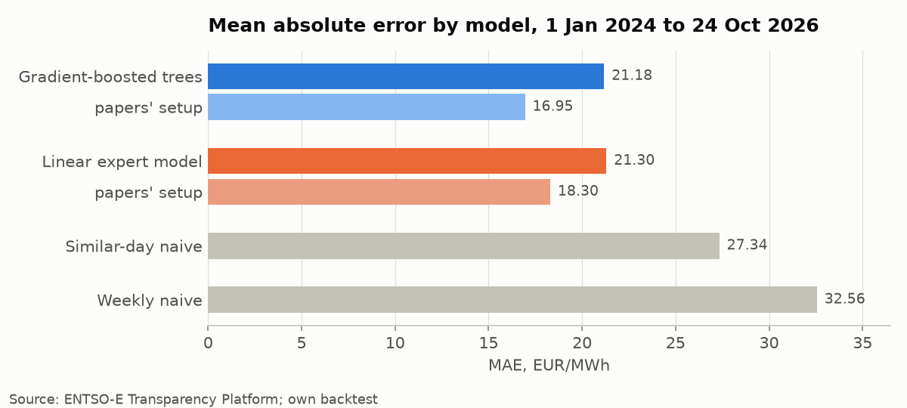

# Polish day-ahead electricity price forecast

## Abstract

This project forecasts the 24 hourly prices of the Polish day-ahead auction at 11:00 Warsaw time on the day before delivery, one hour before the auction closes, using only information published by then. A linear expert model and gradient-boosted trees are tested against two naive benchmarks in a walk-forward backtest over 1,028 delivery days, from 1 January 2024 to 24 October 2026. Both models cut the mean absolute error (MAE) by 22% against the similar-day naive benchmark, to 21.18 EUR/MWh for the trees and 21.30 for the linear model, against 27.34; the difference between the two models is not significant. A post-mortem in [notebook 02](notebooks/02_post_mortem.ipynb) finds that the trees' daily bias follows the change from the wind and solar forecast they saw at 11:00, the one for the day before delivery, to the delivery day's own, published at 18:00 (Spearman rank correlation 0.59 over all days).



*Figure 1. Mean absolute error on the 24,671 hours every model forecast. The lighter bars are the papers' setup ([section 2.2](#22-publication-times-and-assumptions)), which uses the delivery day's wind and solar forecast. From `src/pl_dayahead/evaluate.py`.*

## 1. Introduction

Poland's day-ahead electricity price is set in Single Day-Ahead Coupling, the European day-ahead auction. Bids for delivery day d close at 12:00 Warsaw time on d−1, the gate closure, and the auction sets a price for every hour of d in EUR/MWh, or every quarter-hour since 1 October 2025. A desk that trades in the auction needs its price forecast before gate closure to prepare its bids.

The forecast is issued at 11:00 on d−1, which leaves an hour to turn it into bids. Its target is the price $p_{d,h}$ of each hour h of day d on the Warsaw clock. Since October 2025 that is the mean of the hour's four quarter-hour prices, so the target means the same thing across the whole period. A delivery day has 23 hours on the spring clock change and 25 on the autumn one.

The method follows three reference papers, Lago et al. (2021), Ziel and Weron (2018) and Maciejowska, Uniejewski and Weron (2022), referred to below as the papers. Two choices shape the design: every input must be public at 11:00, checked against its legal publication deadline, and the evaluation goes beyond average accuracy to the days on which the forecast fails.

## 2. Data

### 2.1 Sources and processing

The electricity data comes from the [ENTSO-E Transparency Platform](https://transparency.entsoe.eu/) for the Polish bidding zone: day-ahead prices (12.1.D), the day-ahead total load forecast (6.1.B) and the day-ahead wind and solar generation forecast (14.1.D), with wind onshore plus offshore. It starts on 1 January 2023, which keeps the 2022 gas crisis out of training and leaves one full year before the first test day.

Values are stored hourly. Quarter-hour values are averaged into hours, and an hour counts only if its values are all the same length and together cover 60 minutes; otherwise it is missing.

The carbon price comes from EEX, which runs the primary auctions of emission allowances (EUA) in the EU Emissions Trading System and publishes every result free of charge. It is the clearing price of each auction of general allowances, in EUR per tonne of CO2: 1,039 auctions from 10 January 2022 to 28 October 2026.

The main models leave out fuel and carbon prices, cross-border flows and plant outages. The papers' expert models use only load and renewables forecasts as outside inputs, Lago et al.'s benchmark datasets contain no fuel or carbon prices, and yesterday's prices carry the current cost level into the forecast. Of these inputs, only the carbon price is tested, in two variants.

### 2.2 Publication times and assumptions

The forecast rests on three assumptions about the data:

1. Each series is published exactly at its deadline under EU Regulation 543/2013, because ENTSO-E does not record when each value was published.
2. The stored values are those that were public at the time. ENTSO-E can revise a value after publishing it, and the data is the version downloaded in October 2026.
3. Offshore wind is zero before 18 June 2026, the first delivery day with an offshore forecast, because no Polish offshore farm is assumed to have fed the grid before then.

*Table 1. Publication times around the forecast, Warsaw time: the legal deadlines of the ENTSO-E series under assumption 1, and the result times in EEX's auction reports.*

| Time | Published | At 11:00 on d−1 |
|---|---|---|
| 11:00 to 11:04 on d−2 | Result of an EUA auction held on d−2 (EEX) | Public: the carbon variants' input |
| 13:00 on d−2 | Prices for d−1 (Art. 12(2)(d)) | Public |
| 18:00 on d−2 | Wind and solar forecast for d−1 (Art. 14(2)(d)) | Public: the main models' renewables input |
| 10:00 on d−1 | Load forecast for d (Art. 6(2)(b)) | Public |
| **11:00 on d−1** | **The forecast is issued** | |
| 11:00 to 11:04 on d−1 | Result of an EUA auction held on d−1 (EEX) | Not yet |
| 12:00 on d−1 | Gate closure for d | |
| 13:00 on d−1 | Prices for d | Not yet: the target |
| 18:00 on d−1 | Wind and solar forecast for d (Art. 14(2)(d)) | Not yet: used only by the papers' setup |

The papers give their models the wind and solar forecast for day d and treat it as known on d−1 (Lago et al. 2021). Its deadline is after gate closure, and ENTSO-E does not show whether it was published earlier, so I use the forecast for d−1 in the main models. The same models given day d's forecast, called the papers' setup, are run as variants to measure what that forecast would be worth if it were public by 11:00.

An EUA auction's bidding window closes at 11:00, and EEX's reports for 2022 to 2026 time every general-allowance result between 11:00 and 11:04 on the auction day, so an auction held on d−1 is never public at 11:00. The carbon input is therefore the latest auction held on or before d−2. Auctions pause for up to four weeks over New Year, and the last price carries on until they resume.

## 3. Models

### 3.1 Inputs

The inputs are those of the expert model of Ziel and Weron (2018, Eq. 10), with the two outside inputs of Maciejowska et al. (2022, Eq. 5).

*Table 2. Model inputs for hour h of delivery day d.*

| Input | Definition |
|---|---|
| $p_{d-1,h}$, $p_{d-2,h}$, $p_{d-7,h}$ | Price at hour h one, two and seven days before d |
| $p^{\text{last}}_{d-1}$ | Price at 23:00 on d−1, the hour just before d |
| $p_{d-1}^{\min}$, $p_{d-1}^{\max}$ | Lowest and highest price of d−1 |
| $L_{d,h}$ | Load forecast for hour h of d, in GW |
| $R_{d-1,h}$ | Wind plus solar forecast for hour h of d−1, in GW: the latest due by 11:00 |
| $R_{d,h}$ | Wind plus solar forecast for hour h of d, in GW: the papers' setup only |
| $D_k(d)$ | Six weekday dummies, with Wednesday as the baseline |
| $H(d)$ | 1 on a Polish public holiday, otherwise 0 |
| $C_{d-2}$ | Clearing price of the latest EUA auction held on or before d−2, in EUR/t: the carbon variants only |

Hours follow the Warsaw clock. When the clocks go forward, the missing 02:00 of an earlier day is filled with the mean of 01:00 and 03:00; when they go back, its two 02:00 values are averaged, as in Ziel and Weron. The lowest and highest price of d−1 are left missing if any hour of d−1 is missing. The holiday dummy is my addition. Ziel and Weron leave holidays out to keep the model small, but fitted on the latest year it lowers the forecast in all 24 hours, by up to 30.4 EUR/MWh at 14:00 (`slopes.py`).

Every input is checked against the publication times in Table 1 when the input table is built (`availability.py`), and the build stops if one is late. Three truncation tests check the data as well as the rule. Deleting every price from day d onwards must leave every input for day d unchanged; deleting day d's renewables forecast too must leave every input outside the papers' setup unchanged; and deleting every auction from d−1 onwards must leave the carbon input unchanged.

Load and renewables are the outside inputs because the price follows residual load, load minus wind and solar: the more demand is left for conventional plants, the further up the merit order the auction clears (Figure 2). In notebook 01, Spearman's rank correlation between price and residual load was 0.69 to 0.86 in the years 2023 to 2026, against 0.18 to 0.54 for load alone.


*Figure 2. Price against the residual load forecast, one panel per year. From `notebooks/01_merit_order.ipynb`.*

### 3.2 Benchmarks

The weekly naive copies the same hour one week earlier:

```math
\hat p_{d,h} = p_{d-7,h}
```

The similar-day naive copies the most recent day of the same kind:

```math
\hat p_{d,h} =
\begin{cases}
p_{d-1,h} & \text{if } d \text{ is a Tuesday, Wednesday, Thursday or Friday} \\[4pt]
p_{d-7,h} & \text{if } d \text{ is a Saturday, Sunday or Monday}
\end{cases}
```

From Tuesday to Friday the day before is also a working day, so it is copied. For Saturday, Sunday and Monday the day before is a different kind of day, so the same weekday one week earlier is copied instead. Public holidays get no rule of their own: a holiday on a Thursday is forecast from Wednesday, and the Friday after it from the holiday. This is the naive benchmark of Ziel and Weron (2018, Eq. 9) and the default in epftoolbox, the library that accompanies Lago et al.

### 3.3 Linear expert model

One ordinary least squares regression is fitted for each hour h, so each of its 16 coefficients takes a separate value for every hour:

```math
\begin{aligned}
p_{d,h} = {} & \underbrace{\beta_0 + \beta_1\, p_{d-1,h} + \beta_2\, p_{d-2,h} + \beta_3\, p_{d-7,h}}_{\text{same hour on earlier days}}
\; + \; \underbrace{\beta_4\, p^{\text{last}}_{d-1} + \beta_5\, p^{\min}_{d-1} + \beta_6\, p^{\max}_{d-1}}_{\text{the day before}} \\[8pt]
& + \underbrace{\beta_7\, L_{d,h} + \beta_8\, R_{d-1,h}}_{\text{load and renewables}}
\; + \; \underbrace{\textstyle\sum_{k=1}^{6} \theta_k\, D_k(d) + \delta\, H(d)}_{\text{weekday and holiday}}
\; + \; \varepsilon_{d,h}
\end{aligned}
```

With load and renewables in GW, $\beta_7$ and $\beta_8$ read in EUR/MWh per GW, and the intercept and the dummies in EUR/MWh. Prices enter raw, as in Maciejowska et al. I fit the model by least squares and score it by MAE, as the papers do, so that it stays comparable with them. Lago et al.'s linear benchmark is LEAR, a LASSO model with many more inputs; I chose the expert model of the other two papers because it is the standard small benchmark, with nothing to tune.

### 3.4 Gradient-boosted trees

The trees are scikit-learn's `HistGradientBoostingRegressor`, one model for all 24 hours. Its inputs $x_{d,h}$ are those of the linear model plus the hour h, with the weekday as one number (0 for Monday) instead of dummies. The forecast starts from the median training price $f_0$ and adds 400 regression trees $f_m$, each scaled by the learning rate $\nu = 0.05$:

```math
\hat p_{d,h} = f_0 + \nu \sum_{m=1}^{400} f_m(x_{d,h})
```

Each tree has at most 31 leaves and at least 40 training hours per leaf, and is grown to reduce the absolute error, the measure the model is scored on. With this loss each leaf's value is the median residual of its training hours, and the L2 penalty of 1.0 acts only on the choice of splits. The settings are fixed and the same in every run. Tuning them would need a validation period before the test, and the only data before the first test day is the year the first model trains on. Lago et al.'s nonlinear benchmark is a deep neural network. I use trees instead because a fit takes about a second, which makes daily retraining practical, and they need no architecture search.

### 3.5 Variants

Each variant changes one thing about a main model. In the papers' setup, `linear_papers` and `gbm_papers`, day d's renewables forecast $R_{d,h}$ replaces $R_{d-1,h}$. `gbm_defaults` uses scikit-learn's default learning rate, number of trees, minimum leaf size and L2 penalty, and keeps the absolute-error loss.

`linear_eua` and `gbm_eua` add the carbon price $C_{d-2}$ to the main models; in the linear model it is a seventeenth coefficient per hour, in EUR/MWh per EUR/t. They were set up as variants before they were run, so their result cannot choose the main models.

`linear_asinh` fits the linear model to asinh-transformed prices, as Ziel and Weron do. The target and the six price inputs are transformed with $m$, the median of the training window's prices, and $s$, 1.4826 times their median absolute deviation, and each forecast is transformed back:

```math
z = \text{asinh}\!\left(\frac{p - m}{s}\right), \qquad \hat p = m + s \sinh(\hat z)
```

## 4. Forecast evaluation

### 4.1 Walk-forward backtest

For each delivery day d from 1 January 2024, a fresh model is trained on the 365 days from d−365 to d−1 and forecasts the hours of d. Day d−1's prices come out of the auction on d−2, so every training price was known at 11:00 on d−1.

Retraining every day, as the papers do, gives each forecast the latest prices and the latest relationship between price, load and renewables. The 365-day window is the most the data allows on the first test day and lies within the range of Lago et al.'s windows; being fixed, it gives every forecast the same length of history, with each season in it once. Ziel and Weron use 730 days, and Lago et al. average the forecasts of four windows, from 56 days to 4 years.

A training row with a missing input is dropped. A test hour with a missing input gets no forecast, and every model is scored on the 24,671 hours all of them forecast, so no model gains by skipping hard hours.

### 4.2 Accuracy measures

Accuracy is measured by MAE over the $N$ hours scored, and by relative MAE (rMAE), which divides a model's MAE by the weekly naive's on the same hours (Lago et al.):

```math
\begin{aligned}
\text{MAE} &= \frac{1}{N} \sum_{d,h} \bigl\lvert \hat p_{d,h} - p_{d,h} \bigr\rvert \\[8pt]
\text{rMAE} &= \frac{\text{MAE}}{\text{MAE}_{\text{weekly naive}}}
\end{aligned}
```

Lago et al. recommend the weekly naive for relative MAE, but here it is the weaker of the two naive forecasts, so I state the headline gain against the similar-day naive.

### 4.3 Significance tests

A Diebold-Mariano test on daily MAE decides whether model A is more accurate than model B. With $\text{MAE}_d$ a model's MAE over the hours of day d, and $n$ days:

```math
\begin{aligned}
\Delta_d &= \text{MAE}^{B}_d - \text{MAE}^{A}_d \\[8pt]
\text{DM} &= \frac{\bar\Delta}{\sqrt{\hat\sigma^2 / n}} \\[8pt]
\hat\sigma^2 &= \hat\gamma_0 + 2 \sum_{k=1}^{7} \Bigl(1 - \frac{k}{8}\Bigr) \hat\gamma_k
\end{aligned}
```

Here $\hat\gamma_k$ is the autocovariance of $\Delta_d$ at a lag of k days, and a large DM means A is more accurate. The plain test in Lago et al. uses $\hat\gamma_0$ alone; the Newey-West sum widens the standard error when consecutive days' errors move together, as they do in a volatile week. Every ordered pair of main models gets a one-sided test, and all significant differences survive a Bonferroni correction over the 6 pairs. Each variant is compared with its main model by a two-sided test.

### 4.4 Differences from the reference papers

*Table 3. Where this project departs from the papers.*

| Choice | The papers | This project |
|---|---|---|
| Renewables forecast | For day d, treated as known on d−1 | For d−1; day d's in a variant |
| Holidays | Weekday dummies only | A holiday dummy as well |
| Training window | 730 days (Ziel and Weron); four windows from 56 days to 4 years, averaged (Lago et al.) | 365 days |
| Linear model | LEAR, a LASSO model with many inputs (Lago et al.) | The expert model, by OLS |
| Prices | asinh-transformed (Ziel and Weron) | Raw, as in Maciejowska et al.; asinh in a variant |
| Nonlinear model | A deep neural network (Lago et al.) | Gradient-boosted trees |
| Significance test | Diebold-Mariano | The same, with a Newey-West standard error |
| Target since October 2025 | The papers predate 15-minute products | The mean of the four quarter-hours |

## 5. Results

Every table, including results by period, year, month and local hour and the full Diebold-Mariano table, is in [`reports/results.md`](reports/results.md).

### 5.1 Main models

*Table 4. MAE on the 24,671 hours every model forecast, 1 January 2024 to 24 October 2026.*

| Model | MAE (EUR/MWh) | Relative MAE vs weekly naive | MAE change vs similar-day naive |
|---|---|---|---|
| Gradient-boosted trees (`gbm`) | 21.18 | 0.65 | −22.5% |
| Linear expert model (`linear`) | 21.30 | 0.65 | −22.1% |
| Similar-day naive (`naive_similar_day`) | 27.34 | 0.84 | 0% |
| Weekly naive (`naive_weekly`) | 32.56 | 1.00 | +19.1% |

**Both models cut the error by 22% against the similar-day naive, and they are tied (p = 0.273).** They are the only pair the Diebold-Mariano test cannot separate; every other pair differs with p < 0.001. The trees lead in 2024 (18.59 against 19.09 EUR/MWh) and trail slightly in 2025 and 2026.

**The weekly naive's MAE rose from 29.86 to 36.99 EUR/MWh after 1 October 2025, and every other model's error rose with it.** The trees' relative MAE was 0.65 in both periods, so their error grew in step with the benchmark's. The split cannot separate the switch to 15-minute products from 2026 being a more volatile year.

### 5.2 Variants

*Table 5. Each variant against its main model on the same hours, MAE in EUR/MWh. Differences are computed before rounding, and p is from a two-sided Diebold-Mariano test.*

| Variant | What changes | MAE of the main model | MAE of the variant | Difference | p |
|---|---|---|---|---|---|
| `linear_papers` | The renewables forecast for day d, as in the papers | 21.30 | 18.30 | −3.01 | <0.001 |
| `gbm_papers` | The renewables forecast for day d, as in the papers | 21.18 | 16.95 | −4.23 | <0.001 |
| `linear_asinh` | Fitted on asinh-transformed prices | 21.30 | 20.67 | −0.63 | <0.001 |
| `gbm_defaults` | scikit-learn's default settings | 21.18 | 21.30 | +0.11 | 0.125 |
| `linear_eua` | The carbon price added | 21.30 | 21.28 | −0.02 | 0.810 |
| `gbm_eua` | The carbon price added | 21.18 | 21.12 | −0.06 | 0.529 |

**Day d's renewables forecast would cut the error by 14 to 20%, if it were public by 11:00.** With it, the linear model's MAE falls by 3.01 EUR/MWh and the trees' by 4.23 (both p < 0.001). I would expect a desk with its own weather-based forecast for day d to land between the main models and the papers' setup.

**The tree settings barely matter.** With scikit-learn's defaults the trees' MAE is 0.11 EUR/MWh higher, and the difference is not significant (p = 0.125).

**Fitting the linear model on asinh-transformed prices lowers its MAE by 3.0% (p < 0.001).** The transform damps the pull of spikes on the least-squares fit. I keep raw prices in the main model, because adopting the transform after seeing it win on the test period would choose the model on the test data.

**The carbon price makes no significant difference (p = 0.810 for the linear model and 0.529 for the trees).** It lowers the linear model's MAE by 0.02 EUR/MWh and the trees' by 0.06. A likely reason is that yesterday's prices already carry the cost of carbon into the forecast.

### 5.3 Where the forecast fails

**Hours below 0 or at 250 EUR/MWh and above are 5.3% of all hours but carry 17.7% of the trees' error (Figure 3).** The forecasts there are far too moderate, partly because sorting hours by the actual price puts in those bands the hours where something unforeseen moved the price.


*Figure 3. Share of hours and share of the trees' error by actual price band. From `notebooks/02_post_mortem.ipynb`.*

**The ten worst days, the worst 1% of the 1,028 by gbm's daily MAE, split evenly between forecasts too low and too high.** On five, prices were high all day. On the other five the price fell, four of them with strong wind, and on those five the papers' setup averaged an MAE of 44.8 EUR/MWh against gbm's 67.2. On 12 and 13 January 2026 Poland peaked 255 and 240 EUR/MWh above both Germany and Czechia.

**gbm's daily bias follows the renewables forecast it could not see (rank correlation 0.59).** The daily bias is the mean of forecast minus actual over the day. Over all 1,028 days, its Spearman rank correlation with the change from the forecast gbm saw to day d's own is 0.59, against 0.19 for the papers' setup (1 would mean the bias always rises with the change). On nine of the ten worst days the bias had the same sign as the change. The analysis is in [`notebooks/02_post_mortem.ipynb`](notebooks/02_post_mortem.ipynb).

## 6. Limitations

Assumptions 1 and 2 can be wrong in both directions. The stored load forecast may be a later update than the version public at 11:00, which would flatter the models. Day d's renewables forecast may have been public before 11:00, which would put the papers' setup within reach. The archive cannot settle either question.

The main models see only Polish electricity data, with no fuel, carbon, flow or outage data, so they react to a cost shock only once it shows up in prices; of these inputs, only carbon is tested. Trees cannot forecast outside the price range of their training window; the linear model can, but in this backtest it was also far too low on spikes: in hours at 250 EUR/MWh and above its bias was −92.9 EUR/MWh, against −104.6 for the trees. The target is hourly, while the auction has traded 15-minute products since October 2025, and the results cover one market and one period, 2024 to 2026.

The forecast is a point forecast, one number per hour with no range of likely prices. It is scored on accuracy alone, and what it would be worth to a desk in money, for example as bids in the auction, is not measured.

## 7. Conclusion

With only the information public at 11:00, a regression with 16 coefficients per hour forecasts the Polish day-ahead price as well as gradient-boosted trees. Of the changes tested, day d's renewables forecast is worth the most, 14 to 20% of the error, against 3.0% for the asinh transform and no significant change for the tree settings or the carbon price. That suggests a better wind and solar forecast at 11:00 would help a desk more than a more complex model.

## References

- Lago, J., Marcjasz, G., De Schutter, B., Weron, R. (2021). Forecasting day-ahead electricity prices: A review of state-of-the-art algorithms, best practices and an open-access benchmark. *Applied Energy* 293, 116983. [arXiv:2008.08004](https://arxiv.org/abs/2008.08004)
- Ziel, F., Weron, R. (2018). Day-ahead electricity price forecasting with high-dimensional structures: Univariate vs. multivariate modeling frameworks. *Energy Economics* 70, 396–420. [arXiv:1805.06649](https://arxiv.org/abs/1805.06649)
- Maciejowska, K., Uniejewski, B., Weron, R. (2022). Forecasting electricity prices. [arXiv:2204.11735](https://arxiv.org/abs/2204.11735)
- Diebold, F. X., Mariano, R. S. (1995). Comparing predictive accuracy. *Journal of Business & Economic Statistics* 13(3), 253–263.
- Newey, W. K., West, K. D. (1987). A simple, positive semi-definite, heteroskedasticity and autocorrelation consistent covariance matrix. *Econometrica* 55(3), 703–708.
- Commission Regulation (EU) No 543/2013 on submission and publication of data in electricity markets.

Data: ENTSO-E Transparency Platform; EEX, [EUA primary auction reports](https://www.eex.com/en/market-data/market-data-hub/environmentals/eex-eua-primary-auction-spot-download).

## Repository structure

```
src/pl_dayahead/
  ingest/entsoe.py   download from ENTSO-E, one month at a time, into entsoe_latest
  ingest/eex.py      download EEX's EU ETS auction results into eua_auctions
  store.py           the DuckDB database: the ENTSO-E series, one row per series and time, and the auctions
  staging.py         one row per UTC hour in the hourly table
  timeutils.py       delivery days, clock changes, Polish public holidays, the 11:00 issue time
  availability.py    publication rules and the timing check
  features.py        model inputs, each checked by availability.py
  models/            naive.py, linear.py, boosting.py, and the list of models and variants
  backtest.py        daily walk-forward backtest into the predictions table
  evaluate.py        MAE, relative MAE, Diebold-Mariano tests, reports/results.md, the headline chart
  slopes.py          the linear model's latest coefficients
  style.py           the colours and chart settings shared by evaluate.py and the notebooks
notebooks/
  01_merit_order.ipynb   how the Polish price behaves, and price against residual load
  02_post_mortem.ipynb   where the forecasts fail: error by price band and the worst days
tests/                   pytest suite, 125 tests
```

## Reproducing the results

Requirements: Python 3.13 (the version used here), [uv](https://docs.astral.sh/uv/) and a free ENTSO-E API token (register on the Transparency Platform and request RESTful API access, as its [knowledge base](https://transparencyplatform.zendesk.com/) describes). Put the token in a file named `.env` in the project root:

```
ENTSOE_API_TOKEN=your-token
```

Then, from the project root:

```
uv sync
uv run python -m pl_dayahead.ingest.entsoe
uv run python -m pl_dayahead.ingest.eex
uv run python -m pl_dayahead.staging
uv run python -m pl_dayahead.backtest
uv run python -m pl_dayahead.evaluate
uv run pytest
```

The EEX reports need no token. The data is stored in `data/pl_power.duckdb` and the downloaded reports in `data/eex`, neither of which is part of the repository. The backtest runs every model and variant in about 35 minutes; the four tree models take most of that time, because each fits 1,028 models. Open the notebooks with `uv run jupyter lab`; notebook 02 also downloads neighbouring prices, so it needs the token too.

## Use of AI tools

The code and drafts of the text were written with an AI coding assistant (Claude). The design decisions are mine, each one tied to the references above, and the tests check the rules they set.

## License

MIT. See [LICENSE](LICENSE).
