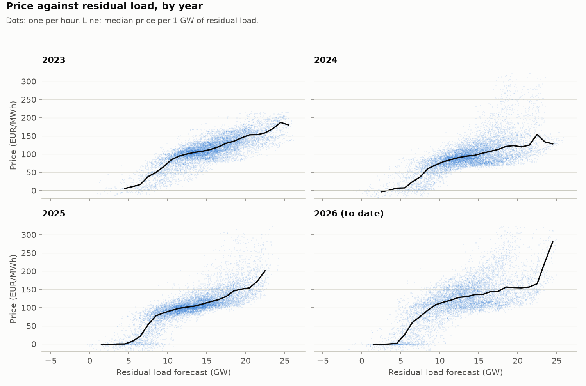
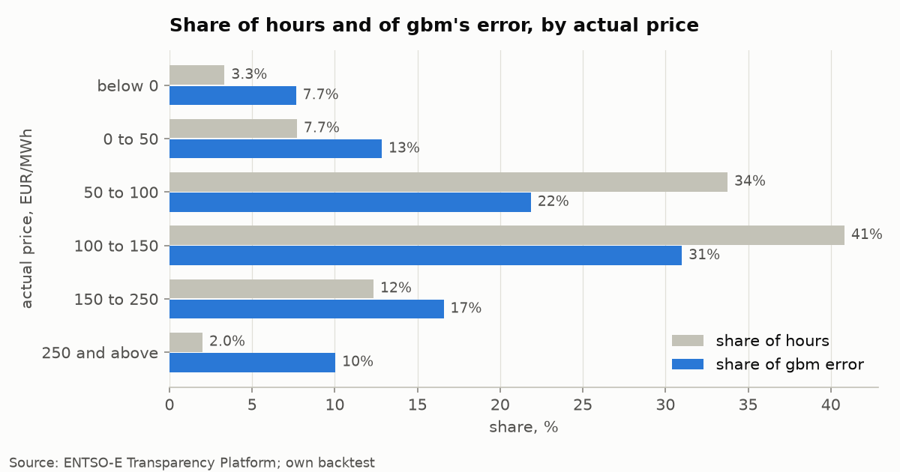

# Polish day-ahead electricity price forecast

This project forecasts the 24 hourly prices of the Polish day-ahead auction for the next delivery day. Each forecast is issued at 11:00 Warsaw time, one hour before the auction closes, and uses only information published by then. The methods follow the electricity price forecasting literature (Lago et al. 2021; Ziel and Weron 2018; Maciejowska, Uniejewski and Weron 2022). A linear expert model and gradient-boosted trees are tested against two naive benchmarks over 1,028 delivery days, from 1 January 2024 to 24 October 2026.

The reference papers feed their models the renewables forecast for the delivery day, which is published at 18:00 the day before, after the auction has closed. The models here use the latest renewables forecast published by 11:00 instead, and the papers' setup is run as a variant to measure what that convention is worth.

## Results

Mean absolute error (MAE) on the 24,671 hours that every model forecast, 1 January 2024 to 24 October 2026.

| Model | MAE (EUR/MWh) | Relative MAE vs weekly naive | MAE change vs similar-day naive |
|---|---|---|---|
| Gradient-boosted trees (`gbm`) | 21.18 | 0.65 | −22.5% |
| Linear expert model (`linear`) | 21.30 | 0.65 | −22.1% |
| Similar-day naive (`naive_similar_day`) | 27.34 | 0.84 | 0% |
| Weekly naive (`naive_weekly`) | 32.56 | 1.00 | +19.1% |

Each variant changes one thing about a main model and is scored on the same hours. The p-value is a two-sided Diebold-Mariano test of the difference.

| Variant | What changes | MAE of the main model | MAE of the variant | Difference (EUR/MWh) | p |
|---|---|---|---|---|---|
| `linear_papers` | The renewables forecast for day d, as in the papers | 21.30 | 18.30 | −3.01 | <0.001 |
| `gbm_papers` | The renewables forecast for day d, as in the papers | 21.18 | 16.95 | −4.23 | <0.001 |
| `linear_asinh` | Fitted on asinh-transformed prices | 21.30 | 20.67 | −0.63 | <0.001 |
| `gbm_defaults` | scikit-learn's default settings | 21.18 | 21.30 | +0.11 | 0.125 |

What the results show:

1. **Using only what was public at 11:00, both models cut the error by 22% against the similar-day naive.** The trees' MAE is 21.18 EUR/MWh and the linear model's 21.30, against 27.34 for the similar-day naive: 22.5% and 22.1% lower.
2. **The trees and the linear model are tied.** The Diebold-Mariano p-value between them is 0.273, the only pair in the test that is not significant. The trees lead in 2024 (18.59 against 19.09 EUR/MWh) and trail slightly in 2025 and 2026.
3. **The papers' timing convention flatters the error by 14 to 20%.** Given the renewables forecast for the delivery day, which ENTSO-E publishes at 18:00 after the auction, the linear model's MAE falls by 3.01 EUR/MWh and the trees' by 4.23 (both p < 0.001). A desk with its own weather-based forecast for day d at 11:00 would land somewhere between the two.
4. **Errors are higher since 1 October 2025 for every model, the naive ones included.** The weekly naive's MAE rises from 29.86 to 36.99 EUR/MWh, while the trees' relative MAE stays at 0.65, so the errors grow with market volatility. The split cannot separate the switch to 15-minute products from 2026 being a more volatile year.
5. **Both benchmarks are shown.** Lago et al. recommend the weekly naive as the benchmark for relative MAE, and it is the weaker of the two here, so the headline uses the similar-day naive.
6. **The tree settings barely matter.** With scikit-learn's default settings the trees' MAE is 21.30 EUR/MWh, 0.11 higher than with the fixed settings, and the difference is not significant (p = 0.125).
7. **Fitting the linear model on asinh-transformed prices, as Ziel and Weron do, lowers its MAE by 3.0% to 20.67 EUR/MWh (p < 0.001).** The transform damps the pull of spikes on the fit. The main model keeps raw prices, as in Maciejowska et al.: adopting the transform after seeing it win on the test period would choose the model on the test data.
8. **The ten worst days split evenly between forecasts too low and too high.** On five, prices were high all day; on the other five the price fell, four of them with strong wind, and on those five the papers' setup, which had day d's renewables forecast, averaged an MAE of 44.8 EUR/MWh against gbm's 67.2. On 12 and 13 January 2026 Poland peaked 255 and 240 EUR/MWh above both Germany and Czechia. The analysis is in `notebooks/02_post_mortem.ipynb`.

Every table (by period, year, month and local hour, the full Diebold-Mariano table and the variants) is in [`reports/results.md`](reports/results.md).



*Price against the residual load forecast (load minus wind and solar), one panel per year, from `notebooks/01_merit_order.ipynb`.*



*Share of hours and share of the trees' error by actual price band, from `notebooks/02_post_mortem.ipynb`.*

## The forecasting problem

- **Market.** The Polish bidding zone of the European day-ahead auction (Single Day-Ahead Coupling). Bids close at 12:00 Warsaw time on the day before delivery. Prices are in EUR/MWh.
- **Target.** One price per delivery hour. Since 1 October 2025 the auction trades 15-minute products; the four quarter-hour prices are averaged into one hourly price, so the target means the same thing across the whole period.
- **Issue time.** 11:00 Warsaw time on the day before delivery (d−1).
- **Delivery day.** Local midnight to local midnight, so 23 hours on the spring clock change and 25 on the autumn one. All timestamps are stored in UTC and converted to Warsaw time only for calendar features and the issue time.

## What the models may see

ENTSO-E does not timestamp each published value, so each series is assumed to be published exactly at its deadline in EU Regulation 543/2013. An input is used only if that deadline falls before the 11:00 forecast.

| Input | Delivery day used | Due by | Public at 11:00 on d−1? |
|---|---|---|---|
| Prices: same hour on d−1, d−2, d−7; last price, minimum and maximum of d−1 | d−1 and earlier | 1 hour after gate closure (Art. 12(2)(d)) | Yes |
| Load forecast | d | 10:00 on d−1 (Art. 6(2)(b)) | Yes, though it may be updated later |
| Wind and solar forecast | d−1 | 18:00 on d−2 (Art. 14(2)(d)) | Yes |
| Wind and solar forecast, papers' setup only | d | 18:00 on d−1 | No |

**Prices are a hard rule.** No price of day d or later enters any input. `availability.py` checks every feature against one rule, an input from an earlier day or from the target day with a deadline by 11:00, and the feature build stops if one breaks it.

**The papers' setup is a variant, never a forecast.** The reference papers use the day-ahead forecasts for the target day as inputs and describe them as available on day d−1 (Lago et al. 2021). They do not compare the publication hour with the gate closure. The variants `linear_papers` and `gbm_papers` do the same, only to measure what the convention is worth.

Two tests check this by truncation. The first deletes every price from day d onwards and requires that no feature of day d changes. The second also deletes day d's wind and solar forecasts and requires that no input of any model outside the papers' setup changes.

## Data

All data comes from the [ENTSO-E Transparency Platform](https://transparency.entsoe.eu/) for the Polish bidding zone, from 1 January 2023: day-ahead prices (12.1.D), the day-ahead total load forecast (6.1.B) and the day-ahead wind and solar generation forecast (14.1.D).

- Values are stored hourly. Quarter-hour values are averaged into hours, and an hour is used only if its values are all the same length and cover 60 minutes; otherwise it is missing.
- ENTSO-E can revise a value after publishing it. Downloading a month again replaces the stored copy, so the models use the latest version available at download time.
- Wind is onshore plus offshore. Offshore counts as zero before 18 June 2026, the first delivery day with an offshore forecast, on the assumption that no Polish offshore farm fed the grid before then.
- Fuel and carbon prices, cross-border flows and plant outages are not used. The reference expert models use only load and renewables forecasts as outside inputs, and Lago et al.'s benchmark datasets contain no fuel or carbon prices. Yesterday's prices carry the current cost level into the forecast.

## Models

**Naive benchmarks.** The weekly naive copies the same hour one week earlier. The similar-day naive copies the previous day for Tuesday to Friday and the same day one week earlier for Saturday, Sunday and Monday; it is the default naive forecast in epftoolbox, the library that accompanies Lago et al.

**Linear expert model.** One ordinary least squares regression for each local hour, 16 coefficients each:

```
price(d,h) = b0 + b1 price(d-1,h) + b2 price(d-2,h) + b3 price(d-7,h)
           + b4 last price(d-1) + b5 min(d-1) + b6 max(d-1)
           + b7 load(d,h) + b8 renewables(h)
           + six weekday dummies + holiday dummy + error
```

This is Ziel and Weron's expert model (2018, Eq. 10) with the two outside inputs of Maciejowska et al. (2022, Eq. 5), plus a holiday dummy. Renewables are wind plus solar for hour h of day d−1, the latest forecast published by 11:00. Wednesday is the baseline weekday.

**Gradient-boosted trees.** scikit-learn's `HistGradientBoostingRegressor`, one model for all 24 hours, with the linear model's inputs plus the hour of the day. It is trained on absolute error, the measure it is scored on. Learning rate 0.05, 400 trees, 31 leaves, at least 40 hours per leaf, L2 regularisation 1.0. The settings are fixed and the same in every run; the variant `gbm_defaults` shows how much they matter.

**Variants.** Each changes one thing about a main model. `linear_papers` and `gbm_papers` use the renewables forecast for day d, as the papers do. `linear_asinh` fits the linear model to asinh-transformed prices, as Ziel and Weron do: each training window's prices are centred on their median and divided by their median absolute deviation before the transform, and the forecasts are transformed back. `gbm_defaults` uses scikit-learn's default learning rate, number of trees, minimum leaf size and L2 penalty.

## Backtest and evaluation

- **Walk-forward with daily retraining.** For each delivery day d, a fresh model is trained on the 365 delivery days ending d−1 and forecasts the hours of d. Day d−1's prices are public by 11:00 on d−1, so every training target was known at the issue time.
- **Missing data.** A training row with a missing input is dropped. A test hour with a missing input gets no forecast, and each model is scored only on the hours every model forecast.
- **Measures.** MAE in EUR/MWh, and relative MAE: a model's MAE divided by the weekly naive's on the same hours (Lago et al.).
- **Significance.** A one-sided Diebold-Mariano test on daily mean absolute error for every ordered pair of main models, with a Newey-West standard error over 7 days of lags because consecutive days' errors are correlated. All significant differences in that table survive a Bonferroni correction over its 6 pairs. Each variant is compared with its main model by a two-sided test.

## Deviations from the papers

| Deviation | Papers | This project | Reason |
|---|---|---|---|
| Renewables forecast | For day d, treated as available on d−1 | For d−1, the latest published by 11:00; day d's in a variant | Day d's forecast is due at 18:00 on d−1, after the auction closes |
| Holiday dummy | Weekday dummies only | Adds Polish public holidays | Holiday prices differ sharply from ordinary weekdays in this data |
| Calibration window | 730 days (Ziel and Weron); an average of four windows from 56 days to 4 years (Lago et al.) | One 365-day window | Inside Lago et al.'s range; it is the most the data allows on the first test day, and keeps the 2022 gas crisis out of training |
| Linear model | LEAR, a LASSO model with many inputs (Lago et al.) | The expert model, by OLS | The standard small benchmark of the other two papers: 16 coefficients per hour, nothing to tune, every coefficient readable |
| Price transformation | asinh of median- and MAD-normalised prices (Ziel and Weron) | Raw prices, as in Maciejowska et al.; asinh in a variant | Coefficients stay in EUR/MWh. The variant is 3.0% more accurate (p < 0.001), but adopting it after the test would choose the model on the test period |
| Nonlinear model | A deep neural network (Lago et al.) | Gradient-boosted trees | About a second per fit, which makes daily retraining practical, and no architecture search |
| Significance test | Diebold-Mariano on the daily L1 loss | The same, with a Newey-West correction | Stricter when consecutive days are correlated |
| Target since October 2025 | The papers predate 15-minute products | Quarter-hours averaged to the hour | One target definition across the whole period |

## Limitations

- Every input is assumed to be published at its legal deadline, because ENTSO-E does not timestamp publications. The stored load forecast may be a later update than the version public at 11:00, and all inputs are the versions downloaded in October 2026, so this cannot be checked from the archive.
- The models see only Polish data, with no fuel, carbon, flow or outage data, so they react to a cost shock only once it shows up in prices.
- Trees cannot forecast outside the price range of their training window. The linear model can, but in this backtest it was also far too low on spikes: in hours at 250 EUR/MWh and above its bias was −92.9 EUR/MWh, against −104.6 for the trees.
- The target is hourly while the auction has traded 15-minute products since October 2025.
- One market and one period, 2024 to 2026.

## Repository

```
src/pl_dayahead/
  ingest/entsoe.py   download from ENTSO-E, one month at a time, into entsoe_latest
  store.py           the DuckDB database: one row per series and time, from the latest download
  staging.py         one row per UTC hour in the hourly table
  timeutils.py       delivery days, clock changes, the 11:00 issue time
  holidays_pl.py     Polish public holidays
  availability.py    publication rules and the timing check
  features.py        model inputs, each checked by availability.py
  models/            naive.py, linear.py, boosting.py, and the list of models and variants
  backtest.py        daily walk-forward backtest into the predictions table
  evaluate.py        MAE, relative MAE, Diebold-Mariano tests, reports/results.md
  slopes.py          the linear model's latest coefficients
notebooks/
  01_merit_order.ipynb   how the Polish price behaves, and price against residual load
  02_post_mortem.ipynb   where the forecasts fail: error by price band and the worst days
tests/                   pytest suite, 109 tests
```

## Running it

Requirements: Python 3.13 (the version used here), [uv](https://docs.astral.sh/uv/) and a free ENTSO-E API token (register on the Transparency Platform and request RESTful API access, as its [knowledge base](https://transparencyplatform.zendesk.com/) describes). Put the token in a file named `.env` in the project root:

```
ENTSOE_API_TOKEN=your-token
```

Then, from the project root:

```
uv sync
uv run python -m pl_dayahead.ingest.entsoe
uv run python -m pl_dayahead.staging
uv run python -m pl_dayahead.backtest
uv run python -m pl_dayahead.evaluate
uv run pytest
```

The data is stored in `data/pl_power.duckdb`, which is not part of the repository. The backtest runs every model and variant; the three tree models take most of its time, because each fits 1,028 models.

## How this was built

The code was written with an AI coding assistant (Claude). The design decisions are mine, each one tied to the papers below, and the tests check the rules they set.

## References

- Lago, J., Marcjasz, G., De Schutter, B., Weron, R. (2021). Forecasting day-ahead electricity prices: A review of state-of-the-art algorithms, best practices and an open-access benchmark. *Applied Energy* 293, 116983. [arXiv:2008.08004](https://arxiv.org/abs/2008.08004)
- Ziel, F., Weron, R. (2018). Day-ahead electricity price forecasting with high-dimensional structures: Univariate vs. multivariate modeling frameworks. *Energy Economics* 70, 396–420. [arXiv:1805.06649](https://arxiv.org/abs/1805.06649)
- Maciejowska, K., Uniejewski, B., Weron, R. (2022). Forecasting electricity prices. [arXiv:2204.11735](https://arxiv.org/abs/2204.11735)
- Diebold, F. X., Mariano, R. S. (1995). Comparing predictive accuracy. *Journal of Business & Economic Statistics* 13(3), 253–263.
- Newey, W. K., West, K. D. (1987). A simple, positive semi-definite, heteroskedasticity and autocorrelation consistent covariance matrix. *Econometrica* 55(3), 703–708.
- Commission Regulation (EU) No 543/2013 on submission and publication of data in electricity markets.

Data: ENTSO-E Transparency Platform.

## License

MIT. See [LICENSE](LICENSE).
